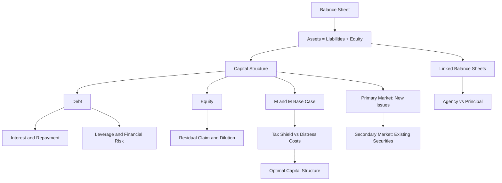
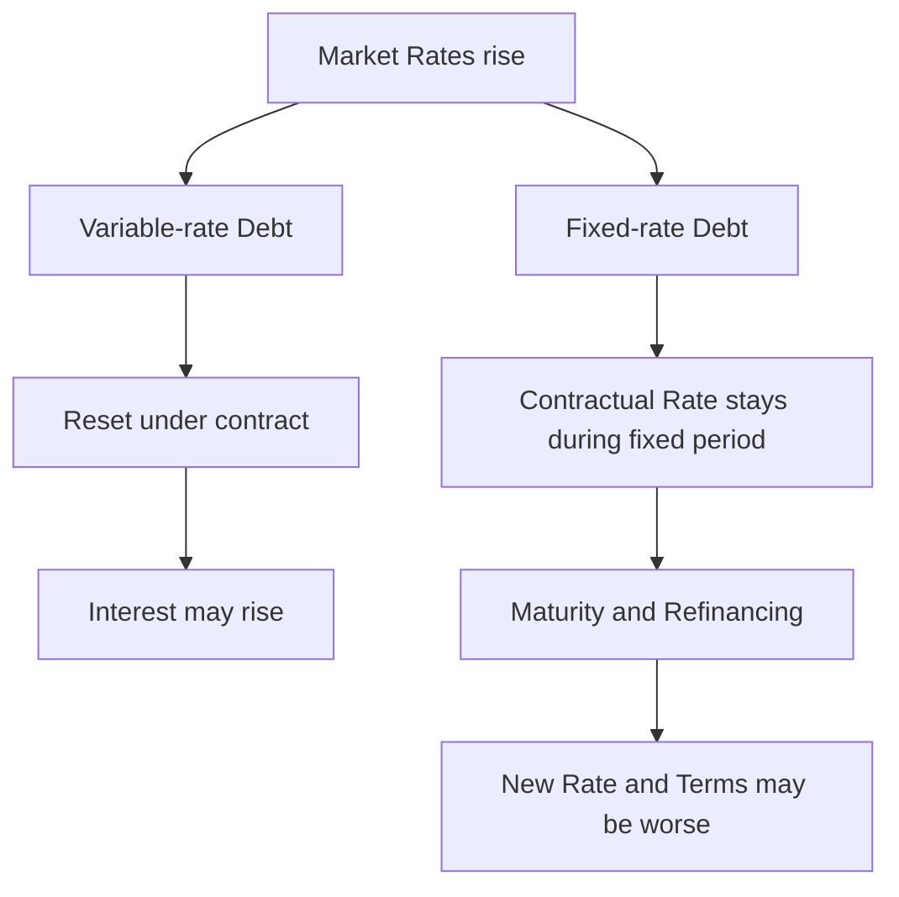

# IC101 L02 — Deep Notes

Короткое повторение: [[IC101 L02 — Quick Review]]. Здесь — механизмы, расчёты Seminar 2, исправления слабых мест и Active Recall.

> [!warning] Source status
> Заметки проверены по **Lecture 2.pdf** и **Seminar 2.pdf**, найденным локально в Downloads. **Transcript не найден и не проверен.** Поэтому это конспект доступных slides и seminar, а не подтверждённая реконструкция устных объяснений. Последние доступные сообщения прежней беседы используются для персонализации; прежний ответ Assistant с Weakness Analysis недоступен как обычный текст. Его выводы не выдуманы.

## Source map

| Label | Источник | Что проверено |
|---|---|---|
| **L** | `Lecture 2.pdf`, 28 страниц; IC101, Professor George Alexandridis, ICMA Centre | Весь текст; визуально ключевые формулы, Balance Sheet, Waterfall, график Capital Structure и Intermediaries |
| **S** | `Seminar 2.pdf`, 12 страниц; IC101, ICMA Centre | Весь текст; визуально ключевые расчёты и Market Scenarios |
| **Conversation** | «Финансовый учебный pipeline», доступные последние сообщения пользователя | Ответы о Financial Risk, Market Scenarios, Debt vs Equity, финальное B |
| **Clarification** | Пояснение автора этих заметок | Вывод из модели, арифметическое уточнение или ограничение формулировки; не дополнительный тезис лекции |

**L12** означает страницу 12 PDF Lecture 2; **S6** — страницу 6 Seminar 2. Внешние новости, годовые отчёты и текущие рыночные данные отдельно не проверялись. Исторические Case Claims не используются как независимо подтверждённые факты.

## Concept Map



Сначала определяй Claims на Balance Sheet. Затем смотри на обязательные Payments, остаток Owners и то, кто получает Cash в конкретной сделке.

## Balance Sheet

### Identity and Equity Cushion

**Balance Sheet** показывает положение на конкретную дату. Основная связь:

$$
\boxed{\text{Assets}=\text{Liabilities}+\text{Equity}}.
$$

$$
\boxed{E=A-L},\qquad \boxed{\text{Equity Cushion}=E/A}.
$$

- **Assets**: Cash, Receivables, Inventories, Investments, Property and Equipment.
- **Liabilities**: Accounts Payable, Borrowings и другие обязательства.
- **Equity**: Share Capital, Retained Earnings и другие компоненты остаточного требования Owners.

[L4–6; S4]

**Current Assets / Current Liabilities** в схеме slides связаны с горизонтом в пределах года. **Non-current** — с более длинным горизонтом. Это учебное деление; полный разбор Accounting Standards сюда не входит.

> [!important] Equity is not Cash
> При Assets = 100 и Liabilities = 70 Equity = 30. Это не означает, что в компании есть отдельный банковский счёт с 30 для Owners. Эти 30 могут быть вложены в оборудование, Inventories или другие Assets.

**Clarification: Liabilities vs Debt.** В общих Balance Sheets Liabilities не равны только Interest-bearing Debt. Например, Bills owed to Suppliers тоже находятся справа. В простых моделях Leverage ниже предполагается, что $L=D$: иных Liabilities нет.

### Transaction Mechanics

**Clarification — учебные записи**, поясняющие Identity, а не дополнительные числовые примеры из slides:

| Событие | Assets | Liabilities | Equity |
|---|---|---|---|
| Компания получила Loan = 10 | Cash +10 | Debt +10 | Без изменения в момент получения |
| Компания выпустила New Shares на 10 | Cash +10 | Без изменения | Share Capital +10 |
| Компания потратила Cash = 10 на Equipment | Cash −10, Equipment +10 | Без изменения | Без изменения в этой простой записи |
| Asset Value упала на 10, Liabilities прежние | Assets −10 | Без изменения | Equity −10 |

Само получение Loan не является Operating Profit: Cash вырос одновременно с обязательством. Покупка Equipment за Cash не означает, что Total Assets автоматически выросли на 10: один Asset заменён другим.

### Apple Example

На **L4–5** дана округлённая схема Apple, USD bn:

| Assets | Amount | Funding | Amount |
|---|---:|---|---:|
| Current Assets | 148 | Current Liabilities | 166 |
| Non-current Assets | 211 | Non-current Liabilities | 119 |
| | | Equity | 74 |
| **Total** | **359** | **Total** | **359** |

$$
E/A=74/359\approx20.6\%.
$$

Это **Book Equity Ratio в учебной таблице**. Оно не равно доле Market Capitalisation в какой-либо сумме. Slides отдельно сопоставляют небольшое Book Equity с большой Market Value; эти величины не взаимозаменяемы.

**L6** раскрывает состав: Cash and Equivalents, Marketable Securities, Receivables, Inventories, Investments, Property and Equipment; справа — Payables, Commercial Paper, Term Debt, Other Liabilities и Equity Components.

> [!note] Rounding audit
> В L6 Non-current Liabilities округлены до 120, тогда как в L5 — до 119. Кроме того, округлённые строки внутри категорий не всегда складываются точно в округлённый Total. Для Identity используй согласованный Summary L4–5: $359=285+74$, $285=166+119$. Не выводи из разницы в 1, что Identity нарушается.

## Debt and Equity

### Two Contracts

| | Debt | Ordinary Equity |
|---|---|---|
| Экономический смысл | Обещание Payments по договору | Ownership и Residual Claim |
| Поставщик Funding | Lender / Bondholder | Shareholder |
| Payments | Interest; Repayment of Principal по условиям | Dividends в учебной модели необязательны |
| Priority | Выше Ordinary Equity | Последняя очередь |
| Upside | Ограничен условиями Debt Claim в модели | Получает остаточный Upside |
| Ownership Dilution | Сам Loan не выдаёт New Shares | New Equity уменьшает прежнюю долю |
| Главная уязвимость | Необходимость Debt Service | Низкая Priority и неопределённый результат |

[L7, L10, L17, L19; S9]

**Retained Profits** — вариант внутреннего Funding в Poll L9: компания использует уже заработанные и оставленные в бизнесе средства. Это не новая продажа Shares внешним Investors.

> [!note] Clarification: “no obligations”
> Формулируй узко: Ordinary Equity не требует договорного Interest и погашения как обычный Loan. Из этого не следует, что у компании вообще нет обязательств перед Shareholders или правил управления.

### Interest vs Debt Principal

**Debt Principal** $D$ — сумма займа. **Interest Rate** $r_D$ — ставка за период. **Interest** $I$ — сумма платы за этот период.

$$
I=r_D\times D.
$$

При $D=£100$, $r_D=6\%$ за год:

$$
I=0.06\times100=£6.
$$

Если по условному договору весь Principal погашается в конце года, Cash Payment в эту дату может включать $100+6=£106$. Но это **не означает Interest = 106**.

**Clarification:** Repayment of Principal уменьшает Cash и Debt. Это отдельный Cash Flow, а не Interest Expense. В задачах Seminar 2 Principal не вычитается из Operating Profit при вычислении ROE. Полный Cash Flow Schedule в условии не задан.

```text
Loan received:       Cash +100 | Debt +100
Annual Interest:     Interest = 6
Principal repaid:    Cash -100 | Debt -100
```

**Principal Intermediary** в [[#Financial Intermediaries]] — другое значение слова Principal: роль Counterparty, а не сумма займа.

## ROE and Leverage

### Model and Calculation Order

В L12 и S5–6, S11 используется упрощённая модель без Taxes и других корректировок после Operating Profit. Equity для знаменателя берётся из условия, а не пересчитывается после результата этого года.

$$
\Pi_E=OP-I=OP-r_DD.
$$

$$
\boxed{ROE=\frac{\Pi_E}{E}=\frac{OP-r_DD}{E}}.
$$

Для отображения в процентах умножь дробь на $100\%$. Обозначения: $OP$ = Operating Profit за период; $\Pi_E$ = Profit to Owners в этой модели; $E$ = Equity из условия.

1. Выпиши $A,D,E$; проверь $A=D+E$.
2. Найди Interest = Rate × Debt.
3. Вычти Interest из Operating Profit.
4. Раздели результат на **Equity**.
5. Проверь знак и переведи в проценты.

> [!warning] Scope of ROE
> В более полном Accounting Calculation могут потребоваться Net Income after Tax и Average Equity. Здесь следуй именно заданной модели: Profit after Interest / Equity. Не подменяй ею любую реальную Financial Statement без проверки определения.

### Lecture Example

На **L12** обе фирмы имеют **£100m Assets**.

| | Firm A: All-equity | Firm B: Half Debt |
|---|---:|---:|
| Equity | £100m | £50m |
| Debt | £0 | £50m |
| Interest Rate | — | 5% |
| Interest | £0 | £2.5m |
| Good Year: Operating Profit | £10m | £10m |
| Good Year: Profit to Owners | £10m | £7.5m |
| **Good Year: ROE** | **10%** | **15%** |
| Bad Year: Operating Profit | £2m | £2m |
| Bad Year: Profit to Owners | £2m | −£0.5m |
| **Bad Year: ROE** | **2%** | **−1%** |

Фирма B оставляет Owners меньше абсолютного Profit в Good Year, чем A: 7.5m против 10m. Но этот остаток делится на вдвое меньшее Equity, поэтому ROE выше. **Higher ROE не означает Higher Total Profit.**

### Negative ROE

Для **Delta в S6**: $A=200$, $E=100$, $D=100$, $r_D=6\%$, $OP=4$.

$$
I=6,\qquad \Pi_E=4-6=-2,\qquad ROE=\frac{-2}{100}=-2\%.
$$

Положительный Operating Profit недостаточен, если он меньше Interest. Interest продолжает учитываться, поэтому остаток отрицателен.

> [!danger] Three different things
> **Negative ROE** при $E>0$: убыток относительно положительного Equity за период. **Negative Equity**: на дату $A<L$. **Inability to pay**: не хватает доступных Cash Flows для обязательных Payments. Эти состояния могут быть связаны, но одно не является автоматическим доказательством другого.

**Clarification:** при $E=0$ ROE по этой формуле не определён. При Negative Equity знак дроби уже не даёт обычной интуиции «положительный ROE = хорошо»; такие случаи не являются моделью задач Seminar 2.

### Leverage Mechanism

**Leverage** — использование Debt в Funding Mix. С одинаковыми Assets компания держит меньше Equity, а Interest становится Claim перед Owners. В результате одинаковое изменение Operating Profit сильнее меняет ROE. [L10–13]

**Clarification — algebraic derivation.** При $A=D+E$, без Taxes и при $E>0$ введём $r_A=OP/A$, то есть Operating Return on Assets в этой простой модели:

$$
ROE=\frac{r_A(D+E)-r_DD}{E}
=r_A+(r_A-r_D)\frac{D}{E}.
$$

- Если $r_A>r_D$, Leveraged ROE выше $r_A$.
- Если $r_A<r_D$, Leveraged ROE ниже $r_A$.
- Если $r_A=r_D$, Leverage не меняет ROE относительно All-equity Case.

Это не универсальная формула любого показателя **ROI**: здесь $r_A$ имеет конкретное определение и допущения.

### Text Graph: ROE vs Operating Profit

Для Delta, $A=200$, Debt Case: $D=100$, $E=100$, $r_D=6\%$:

$$
ROE_U=OP/200,\qquad ROE_L=(OP-6)/100.
$$

```text
ROE (%)     OP=0     OP=4     OP=6     OP=12     OP=20
All-equity     0        2        3         6         10
50% Debt      -6       -2        0         6         14

Fixed Assets; Fixed Debt Rate; no Taxes
All-equity: slope = 0.5 percentage points per £1 OP
50% Debt:   slope = 1.0 percentage point  per £1 OP
Intersection: OP = £12; both ROE = 6%
```

**Два разных порога:** при $OP=6$ Leveraged ROE = 0; при $OP=12$ Leveraged и All-equity ROE совпадают. Не путай Break-even Profit to Owners и точку равенства двух Funding Choices.

## Business Risk and Financial Risk

**Business Risk** возникает из Operations: продажи, Competition, Demand, Operating Costs. Он существует и при нулевом Debt. **Financial Risk** добавляется из-за выбранного Debt Funding и обязательных Payments. [L13; S7]

| S7 Scenario | Answer | Mechanism |
|---|---|---|
| New Competitor cuts Prices | Business Risk | Давление на Sales и Margins |
| Bank Borrowing doubles | Financial Risk | Больше Debt Service при прочих равных |
| Recession cuts Customer Demand | Business Risk | Падает Operating Result независимо от Debt |
| Interest Rates rise on Loans | Financial Risk | Увеличивается Interest, если условия Loans передают рост ставок |

Твой ответ о падении Income и опасности Interest улавливает механизм. Уточнение: **Financial Risk существует и при неизменном Fixed Rate** — Operating Profit может упасть ниже прежнего Interest.

## Fixed-rate Debt, Variable-rate Debt and Refinancing

L15–16 связывают более высокие ставки с дорогим Refinancing; L18 объясняет Rollover. **Разделение Fixed / Variable ниже — Clarification**, которого slides подробно не выводят.

| Contract / Event | Когда может измениться Interest Cost? |
|---|---|
| Fixed-rate Debt | Договорный Rate сохраняется в период фиксации |
| Variable-rate Debt | При предусмотренном договором Reset в зависимости от Rate Formula |
| Refinancing | Новый Loan / Bond получает новые условия; Fixed Rate старого Debt не гарантирует такую же ставку нового |



**Refinancing** — новый Funding для замены старого Debt. **Rollover** — продление Funding через новую договорённость или новый выпуск. **Refinancing Risk** включает риск, что Funding вообще не дадут, а не только риск высокой ставки. [L18]

**Clarification — пример:** у Debt = 100 был Fixed Rate = 5%, то есть Interest = 5. При замене на Debt = 100 под 9% новый Interest = 9. Старый Fixed Coupon не изменился задним числом; изменились условия нового Debt.

> [!warning] Repayment still exists
> Риторика L18 о том, что крупные Borrowers «не погашают, а перекатывают», описывает распространённый механизм Funding в примере. Старое обязательство всё равно нужно исполнить по условиям; New Debt обеспечивает для этого Cash. Refinancing не гарантирован. L18 отдельно упоминает Perpetual Bonds как исключение из обычного Maturity.

## M&M, Tax Shield and Optimal Capital Structure

### M&M Base Case

**Modigliani–Miller Proposition I** на L14: в идеальном мире модели без Taxes и Bankruptcy Costs изменение Debt–Equity Mix само по себе не меняет Firm Value.

$$
\boxed{V_L=V_U}.
$$

$V_L$ — Firm Value при Debt; $V_U$ — Firm Value All-equity Firm с теми же Operations в Base Case.

Это формальная запись идеи L14. Полный набор технических допущений и доказательство в этих slides не приводятся.

> [!important] Firm Value vs ROE
> M&M говорит о стоимости всего бизнеса, а не об одинаковом ROE Owners при любом Leverage. Доли Claims и риск Owners могут измениться, хотя общая стоимость в идеальной модели не меняется. Расчёты L12 не опровергают M&M.

### Tax Shield

В модели L14 Interest уменьшает Taxable Profit. При Tax Rate $T_c$:

$$
\boxed{\text{Annual Tax Shield}=T_c\times I=T_c r_DD}.
$$

Пример **L14**:

$$
D=£100m,\quad r_D=5\%,\quad I=£5m,\quad T_c=25\%.
$$

$$
\text{Annual Tax Shield}=0.25\times5=\boxed{£1.25m}.
$$

Это экономия Taxes за год в заданной модели. Не весь Interest и не часть Debt Principal, которую автоматически возвращают Owners.

**Clarification — раскрытие механизма:** если Taxable Profit до Interest = 20m и Tax Rate = 25%, то без Interest Taxes = 5m. С Interest = 5m Taxable Profit = 15m, Taxes = 3.75m. Разница = 1.25m. Здесь предполагается, что Deduction можно использовать; реальные ограничения налогового режима не рассматриваются.

### Distress Costs and the Optimum

Больше Debt может увеличивать Expected Distress Costs. Поэтому полезный эффект Tax Shield не означает «чем больше Debt, тем лучше». [L14]

**Clarification — conceptual identity**, а не отдельная формула, напечатанная в slides:

$$
V_L\approx V_U+PV(\text{Tax Shields})-PV(\text{Expected Distress Costs}).
$$

Это схема двух сил из L14; она не претендует на полный перечень всех реальных Frictions. **Annual Tax Shield** и **Present Value of Tax Shields** — разные величины.

```text
Firm Value
   ^
   |                       /  Tax Shield only
   |                    / /
   |             ____*____
   |          __/         \__  Actual Value: illustrative hump
   |---------/---------------- M&M Base Case
   |                       
   +---------------------------------> Debt Share
                    ^
              Optimal Mix

Qualitative sketch only; no calibrated scale
```

Читай схему как три идеи: Base Case плоский; Tax Shield поднимает Value; на большом Debt Distress Costs могут перевесить дополнительную выгоду.

**Optimal Capital Structure** — Mix, при котором Firm Value максимальна в рассматриваемой модели. На рисунке L14 пик обозначен примерно у 40% Debt; это **иллюстрация**, а не универсальная рекомендация каждой фирме. Slides не дают метода для точного выбора реального процента Debt.

> [!note] Scope boundary
> M&M II, WACC Derivation и формула $PV(\text{Tax Shield})=T_cD$ не выводятся в предоставленных slides. Здесь они не представлены как обязательный материал Lecture 2.

## Bankruptcy, Equity Cushion and Cash-flow Waterfall

### Assets Are the Resource; Equity Is the Residual

S4: $A=100$, $D=70$, $E=30$. При неизменном Debt падение Assets сначала уменьшает Equity.

**Clarification — simple Liquidation Model**, одна Debt Class, без Fees и других Claims. Пусть $A_{\text{realised}}$ — полученные от Assets средства:

$$
\text{Debt Recovery}=\min(A_{\text{realised}},D),
$$

$$
\text{Ordinary Equity Payout}=\max(A_{\text{realised}}-D,0).
$$

| Realised Assets | Debt Claim | Debt Recovery | Equity Payout | Debt Shortfall |
|---|---:|---:|---:|---:|
| 100 | 70 | 70 | 30 | 0 |
| 80 | 70 | 70 | 10 | 0 |
| 70 | 70 | 70 | 0 | 0 |
| 60 | 70 | 60 | 0 | 10 |

При Assets = 60 алгебраический остаток $A-D=-10$ показывает недостаток покрытия Claims. **Equity Payout не равен −10:** в модели Ordinary Shareholders ничего не получают. L19 объясняет Limited Liability Owners в стандартной ситуации владения Shares.

> [!danger] Threshold correction to S4
> S4 говорит, что при падении Assets на 30 Equity исчезает и Lenders начинают терять. Строго по его же числам: при $A=70$ Lenders ещё получают ровно 70. Их Shortfall появляется **ниже 70**. Это уточнение границы, а не смена модели.

### Payment Priority vs Loss Absorption

Учебная очередь **L17**:

```text
Cash available from Assets
            |
            v
1. Senior Lenders / Secured Banks and Bonds
            |
            v
2. Mezzanine / Junior Debt
            |
            v
3. Preference Shares
            |
            v
4. Ordinary Shareholders: residual only
```

**Payment Priority:** сверху вниз. **Loss Absorption:** Ordinary Equity исчезает первой; затем нехватка затрагивает более старшие Claims. Поэтому **Last Paid = First Loss**.

**Junior Debt** стоит ниже Senior Debt; в L17 более низкая Priority объясняет более высокий требуемый Return. **Preference Shares** в схеме стоят после Debt, но до Ordinary Shares; slides описывают их как Hybrid с Fixed Dividend и обычно без Vote. Не приравнивай этот Dividend автоматически к Interest по обычному Loan.

**Clarification:** это схема курса. Реальная Liquidation включает больше категорий и специальных правил; точная юридическая очередь здесь не устанавливается. Negative Book Equity, платёжная проблема и формальное Bankruptcy не объявляются синонимами.

## Financial Intermediaries

### Linked Balance Sheets

В **L8** Saver имеет Deposit = £1,000 как Asset. У Bank тот же Deposit является Liability; Loan компании — Asset Bank и Liability Company.

```text
SAVER                  BANK                         COMPANY
Asset: Deposit 1000  =  Liability: Deposit 1000
                       Asset: Loan 1000           =  Liability: Loan 1000
                                                        |
                                                        v
                                                   Uses of Funds
```

**Clarification:** это схема связей Claims, а не полное описание создания банковских Deposits и всех операций Lending. Не нужно считать, что каждая новая Loan обязательно является передачей конкретного Deposit один к одному.

> [!warning] Limit of “every asset”
> Фраза L2/L25 полезна для цепочки Financial Claims, но слишком широка буквально. Equipment или Building — Real Assets и не обязаны быть чьей-либо Liability. Share как Asset Investor соответствует **Equity** Issuer, а не его Debt Liability. Точный принцип: у Financial Claim есть Counterparty и соответствующее требование / обязательство либо Equity Claim.

### Agency vs Principal

Основной тест **L20**: **становится ли посредник владельцем основной Position / Counterparty на собственном Balance Sheet?**

| | Agency / Broker | Principal / Transforming |
|---|---|---|
| Роль | Организует сделку между сторонами | Сам становится Counterparty |
| Основная Position | Не остаётся собственной Investment Position | Попадает на собственный Balance Sheet |
| Доход в схеме L20 | Fee / Commission | Spread или результат принятого риска |
| Примеры | Stockbroker, Corporate-finance Adviser, P2P Platform в Agency Model | Bank, Market Maker, Insurer |

**Bank:** Deposit — Liability, Loan — Asset. **Market Maker:** покупает Security на собственные книги и затем продаёт; возникает Inventory Exposure, а разница Bid и Ask даёт Spread. **Insurer:** принимает Risk через обещание выплат; инвестирует Assets для покрытия Claims. [L20]

**Clarification:** фраза slides «Broker takes no risk» относится к основной Asset Position сделки. Она не доказывает отсутствие всех Operational или других рисков бизнеса. И Principal может получать Fees: таблица показывает различие ролей, а не полный Revenue Model каждой фирмы.

### Balance-sheet X-ray

На **L21–22** даны **stylised** соотношения из отчётов 2024 года:

| Firm | Type | Equity / Assets в slides | Что показывает пример |
|---|---|---:|---|
| Tesco | Supermarket | ~25% | Stores и Inventories; Liabilities включают Suppliers |
| Lloyds | Bank | ~5% | Основное Funding — Deposits и другие Borrowings; тонкий Equity Cushion |
| Schroders | Asset Manager | ~65% | Client Assets under Management не являются автоматически собственными Assets фирмы |

Это характеристики **учебных примеров**, а не нормы для каждой фирмы отрасли или текущие проверенные Ratios. Нельзя на основании одного Equity Ratio установить полную Safety компании. **Assets under Management** и **Assets на собственном Balance Sheet** — разные величины.

## Primary Market and Secondary Market

### The Cash Recipient Test

**Primary Market:** New Securities выдаются Issuer Investors; новый Funding получает Issuer. Примеры L24: New Shares, New Bonds, Rights Issues. **Secondary Market:** уже существующая Security переходит между Investors; Cash от покупки получает Selling Investor. [L23–24; S8, S10]

```text
PRIMARY
Investor -- Cash --> Issuer
Investor <-- New Security -- Issuer

SECONDARY
Buyer -- Cash --> Selling Investor
Buyer <-- Existing Security -- Selling Investor
Issuer: no new proceeds from this trade
```

**Clarification:** Fees могут уходить Broker и другим участникам, но это не превращает обычную Secondary Trade в Primary Funding Issuer. Интерфейс Trading App и количество Shares сами по себе ничего не решают.

### Why Secondary Markets Matter

L24–25 связывают Primary Market с новым Funding, Secondary Market — с **Market Liquidity** и **Price Discovery**. Возможность перепродать Security помогает Investors входить в рынок, хотя деньги конкретной перепродажи не поступают компании.

**Clarification:** Market Liquidity не гарантирует продажу в любой момент по желаемой Price. Фраза L24 «sell whenever you want» — учебное сокращение.

### IPO Caveat

В S8 IPO case явно задан как продажа **New Shares**, поэтому ответ — Primary, Cash to Issuer. **Clarification:** при анализе реального Offering смотри, кто именно продаёт Shares: Issuer или Existing Shareholder. Одного слова IPO недостаточно, чтобы приписать Issuer все возможные Proceeds любой сделки вокруг Listing.

## Seminar 2 — Worked Solutions

> [!note] Question numbering
> PDF называет задания Activity, а не нумерует их Question 1–7. Ниже используется рабочая нумерация по порядку тем и доступным ответам беседы: Balance Sheet, Good Year, Bad Year, Risk, Markets, Funding Choice, Final ROE. Для сверки всегда указана страница PDF.

### Question 1 — Balance Sheet: S4

$$
A=100,\quad D=70,\quad E=100-70=30,\quad E/A=30\%.
$$

Equity — Cushion. При падении Asset Value на 20 остаток = 10. При падении на 30 остаток = 0. Дальнейшее падение создаёт Shortfall Lenders в простой модели.

### Question 2 — Delta Good Year: S5

Delta: $A=£200$, $OP=£20$.

**All-equity:** $E=200$, $D=0$:

$$
ROE_U=20/200=10\%.
$$

**50% Debt:** $E=100$, $D=100$, $r_D=6\%$:

$$
I=6,\quad \Pi_E=20-6=14,\quad ROE_L=14/100=14\%.
$$

Leverage повысил ROE, но Profit to Owners в абсолютных единицах равен 14, а не 20. Equity Funding тоже меньше.

### Question 3 — Delta Bad Year: S6

Теперь $OP=£4$; Funding тот же.

$$
ROE_U=4/200=2\%.
$$

$$
ROE_L=(4-6)/100=\boxed{-2\%}.
$$

Правильная устная цепочка: **Operating Profit положителен → Interest ещё выше → Profit to Owners отрицателен → ROE отрицателен**.

### Question 4 — Risk: S7

1. New Competitor cuts Prices → **Business Risk**.
2. Bank Borrowing doubles → **Financial Risk**.
3. Recession cuts Customer Demand → **Business Risk**.
4. Interest Rates rise on Loans → **Financial Risk**, с уточнением о Rate Reset / Refinancing из [[#Fixed-rate Debt, Variable-rate Debt and Refinancing]].

Для первых и третьих событий задай проверку: «произошло бы это при Debt = 0?» Да — источник Shock в Operations. Debt может усилить последствия, но не меняет первоначальный источник Shock.

### Question 5 — Markets and Cash Recipient: S8

| Scenario | Market | Who Gets the Cash? |
|---|---|---|
| New Shares в IPO case, названном в slides SpaceX | Primary | Issuer в условии |
| Buy 10 Apple Shares через Trading App | Secondary | Selling Investor |
| National Grid issues a New £500m Bond | Primary | National Grid |
| Sell an Existing Gilt to another Investor | Secondary | Ты, как Selling Investor; не Government |

Твой пересказ второго Scenario содержит 2,000 Shares. В источнике — 10. Ответ Secondary остаётся правильным: объём не влияет на New vs Existing.

Третий Scenario в источнике — именно **New Bond Issue**, а не неопределённое «authorized funding». Ключевой признак — новый выпуск и Cash National Grid.

> [!note] Case boundary
> L24 и S2/S8 содержат конкретные исторические утверждения о SpaceX IPO. Эти новости отдельно не проверялись; здесь используется только заданная структура New Shares → Cash to Issuer. Даты, суммы и рекорды не предлагаются как проверенные факты для запоминания.

### Question 6 — £5m Funding Choice: S9

**Дано:** Profitable Founder нуждается в £5m для Growth. Числа Rate, Valuation, объём New Shares и будущие Cash Flows не заданы. Поэтому единственный оптимальный вариант арифметически не определяется.

**Case for Debt:** Founder сохраняет долю Ownership; при благоприятном Operating Return ROE может вырасти; L14 добавляет возможный Tax Shield. Но нужны обязательные Interest и Repayment / Refinancing, а слабый год усиливает Financial Risk.

**Case for Equity:** нет договорного Interest и погашения как по Loan; New Investors разделяют Downside. Но Founder отдаёт часть Residual Claim, будущего Upside и, в зависимости от прав и долей, влияния на решения.

> [!check] Exam-ready answer
> Debt avoids ownership dilution and may increase ROE, but creates mandatory debt-service payments and financial risk. New equity avoids those debt-service obligations and shares the downside, but dilutes ownership and future residual claims. The choice depends on cash-flow resilience, borrowing terms and the value placed on ownership and control.

**Уточнения к твоему ответу:**

- «Interest Rate может вырасти» — верно при Variable-rate Reset или новых условиях Refinancing, не автоматически у любого Fixed-rate Loan.
- «С Debt Profit и ROI выше» — слишком широко. В одинаковом Operating Business Interest уменьшает Profit to Owners; ROE может вырасти из-за меньшего Equity.
- «Equity — нет никаких обязательств» — замени на отсутствие обязательного Interest и Repayment как по обычному Debt.
- «Продал долю — потерял Control» — не автоматически. **Dilution** гарантирует меньшую процентную долю при New Shares прежним Owners без участия; **Control** зависит от голосов и прав.
- «Меньшая доля — меньше абсолютного дохода» — только при сопоставимом общем результате. Funding Growth может увеличить общий результат.

**Clarification — ownership arithmetic:** Founder владеет 100 Shares, выпущено 25 New Shares другому Investor. Доля Founder = $100/125=80\%$, а не 75%. Если весь Profit остаётся 100, его пропорциональный Claim = 80; если после Growth Profit = 150, Claim = 120. Этот пример показывает различие Share и Amount; он не прогнозирует результат проекта и не предполагает автоматический Dividend.

### Question 7 — Final ROE: S11

$$
A=£300,\quad OP=£30,\quad E=£200,\quad D=£100,\quad r_D=6\%.
$$

$$
I=0.06\times100=£6.
$$

$$
\Pi_E=30-6=£24,\qquad ROE=24/200=\boxed{12\%}.
$$

**Твой ответ B верный.** A = 10% получается при $30/300$: это Operating Profit / Assets, а не требуемый ROE. C = 15% получается при $30/200$: забыли Interest. D = 8% получается при $24/300$: Interest учли, но выбрали Assets вместо Equity.

## Weakness Analysis

Это рабочая диагностика по указанным пользователем слабым местам и видимым ответам. Полная прежняя проверка и все ранние ответы недоступны, поэтому отсутствие ошибки в доступном фрагменте не считается доказательством полного освоения.

| Focus | Что видно / что нужно закрепить | Corrective Habit | Mastery Check |
|---|---|---|---|
| Negative ROE | Пользователь отдельно указал как слабое место | Всегда писать $OP-I$ до деления | Объяснить $4-6=-2$, затем −2% |
| Interest vs Debt Principal | Требует закрепления по запросу | Подписывать £100 Debt и £6 Annual Interest | Рассчитать ROE без вычитания всего Principal |
| Debt–Equity Trade-off | Хорошо замечены обязательные Payments и Dilution; слишком широк вывод о Profit / ROI | Разделять Operating Profit, Profit to Owners, ROE, Ownership Share | Объяснить 14% ROE при £14 вместо £20 Profit |
| Primary vs Secondary | В поздних ответах 2–4 классифицированы верно; ранее была самокоррекция | После Market всегда называть Cash Recipient | New Bond → Issuer; Existing Share → Seller |
| Bankruptcy: Assets vs Equity | Указано как слабое место; старый ответ не виден | Отдельно Resource и Residual Claim | При $A=60,D=70$ Recovery = 60, Equity Payout = 0 |
| M&M / Tax Shield / Optimal Mix | Указано для закрепления | Сначала Base Case, затем две Frictions | Объяснить, почему Highest ROE не равно Highest Firm Value |
| Fixed / Variable / Refinancing | В твоём ответе риск роста Rate указан без типа Debt | Сначала спрашивать, какой Contract и когда Reset | Fixed Coupon сегодня и более дорогой новый Loan завтра |
| Final ROE | B совпал с S11 | Сохранять цепочку Interest → Residual → Equity | Получить 12% самостоятельно, без вариантов |

> [!tip] 60-second correction loop
> Назови Definition → выпиши Cash Flow → выбери Denominator → проверь знак → объясни экономический смысл. Для Market Question вместо Denominator спроси: **Who gets the cash?**

## Active Recall — Practice Set

Пиши решение до открытия Answers. **P1–P6** опираются на числа источников; **P7–P12** — дополнительные учебные проверки, а не новые задачи из Seminar PDF.

### P1 — Equity Cushion

Assets = 100, Debt = 70. Найди Equity и Cushion. Если Assets упали до 70, сколько получают Lenders в простой Liquidation Model?

> [!check]- Answer P1
> Equity = 30; Cushion = 30%. При Realised Assets = 70 Lenders получают все 70, Equity Payout = 0. Их Shortfall начинается при Assets ниже 70.

### P2 — Delta Bad Year

Assets = 200, Equity = 100, Debt = 100 под 6%, Operating Profit = 4. Найди Interest, Profit to Owners, ROE. Почему положительный Operating Profit не спасает ROE?

> [!check]- Answer P2
> Interest = 6; Profit to Owners = −2; ROE = −2%. Interest выше Operating Profit. Делить надо на 100 Equity; Debt Principal из Operating Profit не вычитается.

### P3 — Lecture vs Seminar

Почему Bad Year даёт −1% в Lecture Example и −2% в Delta Example?

> [!check]- Answer P3
> Условия разные. L12: $OP=2m$, $D=50m$, Interest = 2.5m, $E=50m$ → −1%. S6: $OP=4$, $D=100$, Interest = 6, $E=100$ → −2%. Нельзя смешивать числа двух примеров.

### P4 — Cash Recipient

New National Grid Bond; Existing Apple Share; Existing Gilt, который продаёшь ты. Для каждого назови Market и Cash Recipient.

> [!check]- Answer P4
> Primary → National Grid. Secondary → Selling Investor. Secondary → ты как Seller Gilt; Government не получает новый Funding от этой перепродажи.

### P5 — Tax Shield

Debt = £100m, Rate = 5%, Tax Rate = 25%. Сколько Interest и Annual Tax Shield? Это уже Present Value?

> [!check]- Answer P5
> Interest = £5m; Annual Tax Shield = £1.25m. Это годовая сумма в модели, не Present Value потока всех будущих Tax Shields.

### P6 — Final ROE without Options

Assets = 300, Equity = 200, Debt = 100, Rate = 6%, Operating Profit = 30. Найди ROE и объясни, почему не 10%, 15% или 8%.

> [!check]- Answer P6
> $(30-6)/200=12\%$. 10% — до Interest и на Assets; 15% — на Equity, но забыли Interest; 8% — после Interest, но на Assets.

### P7 — Fixed vs Variable

Market Rates выросли. Компания имеет Fixed-rate Debt до следующего года. Обязательно ли текущий Interest вырос? Что изменится при Refinancing?

> [!check]- Answer P7
> Нет: договорный Rate в период фиксации сохраняется. Новый Funding может иметь более высокий Rate или оказаться недоступным. Variable-rate Debt может передать рост ставок при Reset по Contract.

### P8 — Value vs Return

Student говорит: «Debt поднял ROE, значит M&M неверна». В чём ошибка?

> [!check]- Answer P8
> Он смешал Owners' ROE и Firm Value. Leverage меняет распределение результатов и риск Equity. M&M Base Case говорит об общей стоимости при идеальных допущениях.

### P9 — Limited Liability and Assets

Realised Assets = 60, Debt Claim = 70. Найди Recovery, Shortfall и Ordinary Equity Payout. Нужно ли писать Equity Payout = −10?

> [!check]- Answer P9
> Recovery = 60; Debt Shortfall = 10; Equity Payout = 0. Алгебраический остаток −10 не является отрицательной выплатой Owners в заданной Limited-liability Model.

### P10 — Agency vs Principal

Broker свёл две стороны за Fee; Market Maker купил Shares на свои книги перед перепродажей. Кто действует как Agency, кто как Principal? Значит ли это, что Broker вообще не имеет рисков?

> [!check]- Answer P10
> Broker — Agency; Market Maker — Principal. Broker не принимает основную Investment Position этой сделки, но из этого не следует отсутствие всех рисков бизнеса.

### P11 — Dilution

У Founder 100 Shares; выпущено ещё 25 New Shares внешнему Investor. Найди новую долю Founder. Следует ли из этого автоматическая потеря Control или снижение абсолютного Profit Claim?

> [!check]- Answer P11
> $100/(100+25)=80\%$. Автоматическая потеря Control не следует; важны права и распределение голосов. Абсолютный Profit Claim зависит также от общего результата бизнеса, не только от доли.

### P12 — Transfer Question

Company: Assets = 500, Debt = 200, Equity = 300, Interest Rate = 5%. В Good Year Operating Profit = 50; в Bad Year = 5. Найди оба ROE и сравни с All-equity Firm с теми же Assets и Operating Profit.

> [!check]- Answer P12
> Interest = 10. Leveraged: Good Year $(50-10)/300\approx13.33\%$; Bad Year $(5-10)/300\approx-1.67\%$. All-equity: $50/500=10\%$ и $5/500=1\%$. Leverage усиливает результаты в обе стороны. Это дополнительный пример, не число из slides.

## Source audit

| Потенциальная путаница | Что говорит источник | Как учтено в заметках |
|---|---|---|
| Полнота источников | Transcript в доступных файлах не найден | В обоих файлах `transcript_verified: false`; устные пояснения не приписаны преподавателю |
| Нерелевантный файл с похожим названием | `IC103 L02 — Key Takeaways.pdf` визуально относится к **IC103: Elasticity and Consumer Choice** | Исключён из содержания IC101 |
| Apple Totals | L4–5: 359 = 285 + 74; L6 содержит отдельные округлённые строки | Для Identity использован согласованный Summary; Rounding Difference отмечен |
| Equity Cushion Boundary | S4: Assets 100, Debt 70, Equity 30; текст сокращённо говорит о потерях Lenders при падении на 30 | Уточнено: при 70 они ровно покрыты, Shortfall начинается ниже 70 |
| Negative ROE | L12: −1%; S6: −2% | Оба результата сохранены с разными исходными данными |
| Profit terminology | L12 кратко пишет Profit; S5–6 и S11 явно отделяют Operating Profit и Interest | В расчетах $OP$ понимается до Interest, $\Pi_E$ — после Interest; Taxes в этих задачах не моделируются |
| Every Asset | L2/L25 дают широкую формулировку о чужой Liability | Ограничена цепочками Financial Claims; Real Assets и Equity Claims оговорены отдельно |
| No Risk / No Obligations | L7 и L20 используют учебные сокращения | Уточнены границы: нет Debt-service Obligation у Ordinary Equity; Broker не держит основную Asset Position, но это не отсутствие всех рисков |
| Rising Rates | S7 называет рост Rates Financial Risk; L15–18 подчёркивают Refinancing | Fixed / Variable / Reset / Refinancing разделены как Clarification |
| Optimal Debt Share | Рисунок L14 показывает Sweet Spot около 40% | Не превращён в универсальную норму; M&M II и WACC не добавлены как материал лекции |
| Principal | L20 — роль посредника; в Loan Calculation — сумма Debt | Значения разделены |
| Market Scenario 2 | S8: 10 Apple Shares; Conversation: 2,000 Shares | Сохранено число PDF, отмечено расхождение; классификация не меняется |
| Seminar Numbering | S4–9 — Activities, S11 — Exam-style Question | Рабочие Question 1–7 не представлены как исходная печатная нумерация |
| Historical Cases | L15–19, L24 и S2 содержат Debt / Default / IPO / Buyback Claims | Механизмы сохранены; статистика и исторические суммы не выданы за независимо проверенные текущие факты |
| Approximate Industry Ratios | L22 прямо называет их Stylised из отчётов 2024 | Не представлены как нормативы, текущие данные или полный Safety Test |

## Revision Checklist

- [ ] Восстановить $A=L+E$ и объяснить, почему Equity не является Cash.
- [ ] Получить Interest из Rate × Debt и отделить Repayment of Principal.
- [ ] Рассчитать Delta ROE: 10%, 14%, 2%, −2%.
- [ ] Объяснить Higher ROE при Lower Absolute Profit to Owners.
- [ ] Разделить Business Shock и Financial Amplification.
- [ ] Разделить Fixed-rate, Variable-rate и Refinancing Exposure.
- [ ] Рассказать цепочку M&M Base Case → Tax Shield → Distress Costs → Optimal Mix.
- [ ] Восстановить Payment Waterfall и объяснить First Loss.
- [ ] Для каждой Market Transaction назвать Cash Recipient.
- [ ] Отличить Agency от Principal по собственной Position.
- [ ] Получить Final ROE = 12% без вариантов ответа.

L28 рекомендует Chapters 2–3, pp. 28–52, Blackboard Quiz и сравнение Bank / Non-financial Firm через $E/A$ в LSEG Workspace. Это задания из slides; учебник и Workspace здесь не проверялись.

Возвращение к короткой версии: [[IC101 L02 — Quick Review]].
