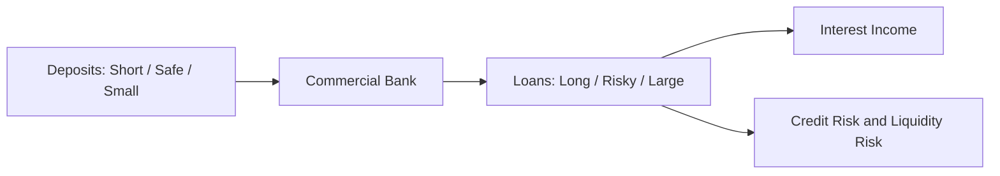
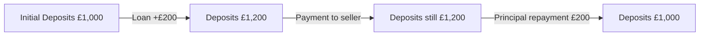
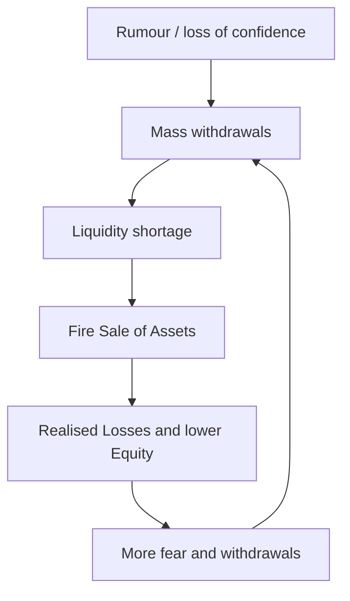

# IC101 L03 — Deep Notes

> [!info] Навигация и границы источников
> Быстро повторить тему: [[IC101 L03 — Quick Review]].  
> **Основной источник:** *IC101 Lecture 3 — Commercial, Investment and Central Banks*, 32 slides + transcript.  
> **Практика:** *IC101 Seminar 3 — Inside a bank: fragile by design*, 12 slides.  
> Явные пометки **[Дополнение]** объясняют модель сверх буквального содержания лекции; они не выдаются за цитаты преподавателя.

## Карта лекции

1. [[#1. Commercial Banks — what a bank really is]]
2. [[#2. Bank Transformation — why banks are useful and fragile]]
3. [[#3. Money Creation — loans create deposits]]
4. [[#4. Credit Risk, Equity and Bank Fragility]]
5. [[#5. Bank Runs — Illiquidity vs Insolvency]]
6. [[#6. Banking Safety Net and Regulation]]
7. [[#7. Central Banks and Monetary Policy]]
8. [[#8. Investment Banks and Capital Markets]]
9. [[#9. Seminar 3 — worked problems]]
10. [[#10. Personal Weakness Analysis]]
11. [[#11. Active Recall — practise without notes]]

---

## 1. Commercial Banks — what a bank really is

**Lecture slides 2–4; transcript opening.**

### What is a Commercial Bank?

Commercial Bank — учреждение с Banking Licence, которое принимает **Deposits**, обслуживает **Payments** и предоставляет **Loans**. По лекции около **97%** денег в UK (в рассматриваемом денежном агрегате) представляют собой **Bank Deposits**, а не Coins и Notes. Это приближённая пропорция из материалов курса, не универсальная константа.

### Один Deposit — два взгляда

Если студент внёс **£1,000** в банк:

| Для студента | Для банка |
|---|---|
| £1,000 — **Asset**, право получить деньги | £1,000 — **Liability**, обязательство вернуть деньги |

Если банк выдаёт другому клиенту Loan **£500**:

| Для Borrower | Для банка |
|---|---|
| £500 Loan — **Liability** | £500 Loan — **Asset** |

$$
\boxed{\text{Assets}=\text{Liabilities}+\text{Equity}}
$$

- **Assets** банка: Loans, Cash & Reserves, Bonds и др.
- **Liabilities** банка: Deposits клиентов, Borrowings.
- **Equity**: разница Assets − Liabilities; финансирование Owners и Retained Earnings.

> [!important] Почему Deposits особенные
> Банк обещает **фиксированную номинальную сумму**: £1 Deposit = обязательство вернуть £1. Многие Deposits доступны **On Demand**. При этом Loans могут быть долгосрочными и рискованными. Именно несовпадение сроков и рисков объясняет хрупкость Banking System.

### Роль Payments

При оплате картой или банковским переводом чаще всего перемещаются записи о Deposits, а не пачки физического Cash. Физические Notes — лишь малая часть денежных средств из иллюстрации лекции.

**Связи:** [[#2. Bank Transformation — why banks are useful and fragile]], [[#3. Money Creation — loans create deposits]].

---

## 2. Bank Transformation — why banks are useful and fragile

**Lecture slides 5–7; Lloyds case на slide 6.**

### Transformation: Short / Safe / Small → Long / Risky / Large

| Deposits | Loans | WHY |
|---|---|---|
| **Short** | **Long** | Withdrawals возможны сегодня, Mortgage гасится 25–30 лет |
| **Safe** (fixed nominal claim) | **Risky** | Loan Borrower может не вернуть |
| **Small** (many savers) | **Large** (large borrowers) | Банк объединяет много финансовых требований |



### Maturity Transformation

**Definition (B1–B2):** *A bank borrows short and lends long.*

Пример: клиент имеет £10,000 в доступном Deposit, а банк держит Mortgage, который будет возвращаться 25 лет. У банка есть право получать будущие платежи, но Depositor хочет получить деньги сегодня.

**WHY it creates Liquidity Risk:**

`Deposits repayable on demand → long-term Loans cannot be recalled instantly → possible withdrawals > immediately available liquidity → bank may become Illiquid.`

### Interest Rate Spread: why do banks lend?

Условный пример ставок из Transcript:

- Interest paid to Depositors: **2.5%**.
- Interest charged on Loans: **5.5%**.
- **Interest Rate Spread:** 5.5% − 2.5% = **3 percentage points**.

Это **не Net Profit**: доход необходимо сопоставить с Credit Losses, Operating Costs и другими обязательствами. Ставки приведены как учебный пример, а не сегодняшний актуальный рынок.

### Risk Transformation and Diversification

Если банк имеет один большой Loan, Default одного Borrower может создать большой Loss. Если банк имеет много достаточно разнообразных Loans, часть Default ожидаема и средние результаты устойчивее — интуиция **Law of Large Numbers**.

> [!warning] Не путать Diversification и отсутствие Risk
> Общие Economic Shocks могут ухудшать платежеспособность многих Borrowers одновременно. **Diversification reduces some risk; it does not eliminate Credit Risk.**

### Реальные числа со slide 6

Lloyds: около **£496bn Deposits** на стороне банковских обязательств и **£481bn Loans** на стороне Assets (показано на слайде). Основная идея не в том, что каждая конкретная монета Deposit напрямую превращается в конкретный Loan, а в несоответствии **withdrawable Deposits** и **long-duration Loans**.

---

## 3. Money Creation — loans create deposits

**Lecture slides 8–9; transcript 17:59–24:00.**

### 3.1 How can a bank create money?

Начальное количество Bank Deposits в упрощённом примере: **£1,000**. Банк одобряет Loan **£200**, зачисляя £200 Borrower на Deposit Account.

| Bank Balance Sheet Change | Assets | Liabilities |
|---|---:|---:|
| New Loan | **+£200 Loan** | **+£200 Deposit** |

**Bank Deposits in economy:** £1,000 → **£1,200**.

> [!important] Почему Debt ≠ Money Supply
> Borrower **должен £200** — это Debt. Но он также получил **£200 Bank Deposit**, которым может расплачиваться. Debt не отменяет существование денег как Bank Deposits. Money Supply увеличился, хотя **Net Wealth** не вырос автоматически на £200.

### 3.2 What if the Borrower buys something?

Borrower оплачивает ноутбук £200 → Deposit Borrower −£200; Deposit продавца +£200. **Total Bank Deposits остаются £1,200** (если иных операций нет).

`Transfer changes who holds the Deposit; it does not, by itself, create or destroy aggregate Deposits.`

### 3.3 Loan repayment destroys Bank Deposits

Borrower зарабатывает деньги и возвращает **£200 Loan Principal**. Банк одновременно уменьшает:

- **Asset**: outstanding Loan −£200;
- **Liability**: Deposit −£200.

Теперь Deposits: **£1,200 → £1,000**. Соответствующие Deposit Money исчезают из Money Supply, а не переходят другому Depositor как при обычном Transfer.



### 3.4 Where does Interest go?

Если Loan Principal = £500 и Interest за период = £50, Borrower возвращает **£550**, где **£500 — Principal** и **£50 — Interest Income**. Interest не является новым Loan Principal: это платёж банку из существующих средств. Он **не создаёт автоматически £50 новых Bank Deposits**.

**[Дополнение — баланс счета при Interest]:** когда Borrower платит Interest со счёта в банке, его Deposit уменьшается, а заработанный банком доход влияет на его Profit / Equity. Впоследствии Salaries, Dividends и другие расходы банка могут вновь привести к Deposits получателей. Поэтому нельзя считать Interest дополнительным Money Creation.

### 3.5 Why isn't Money Creation unlimited?

По slide 9 банк ограничен:

1. **Creditworthiness** — нужен Borrower, который способен вернуть Loan.
2. **Profitability** — ожидаемые доходы должны оправдывать Risk и Costs.
3. **Capital Requirements** — банк должен выдерживать потенциальные Losses.
4. **Settlement Liquidity / Cost** — для расчётов между банками нужны Central Bank Reserves и Liquidity.

**Interest Rate Link:** Bank Rate ↓ → Loans могут стать дешевле → Borrowing ↑ → новые Deposits ↑. Связь возможная, не гарантированная.

### 3.6 Важная связь с историей банков

Transcript приводит Goldsmiths, принимавших Gold Deposits и выдававших Loans, оставляя часть золота в Reserve. **[Дополнение]** Нужно отличать физическую выдачу уже существующих Coins (сама по себе не создаёт Coins) от выдачи transferable bank claims или записи нового Deposit (создание Deposit Money). Computers сделали бухгалтерские записи быстрыми, но не изобрели Credit.

---

## 4. Credit Risk, Equity and Bank Fragility

**Lecture slides 10–13; Seminar 3 slides 4–7.**

### 4.1 Why a thin Equity Cushion matters

В slide 10:

| Before Credit Loss | Amount |
|---|---:|
| **Assets (Loans)** | £105 |
| **Liabilities (Deposits)** | £100 |
| **Equity** | £5 |

Если Loans теряют **6% от £105**:

$$
\text{Loss}=0.06\times105=£6.30
$$

$$
\text{New Assets}=105-6.30=£98.70
$$

$$
\text{New Equity}=98.70-100=\boxed{-£1.30}
$$

До учёта других доходов банк **Insolvent**. При фиксированных Liabilities весь Loss сначала уменьшает Equity.

### 4.2 Expected Loss — formula and meaning

$$
\boxed{EL=PD\times LGD\times\text{Loan Amount}}
$$

| Variable | Definition | Example |
|---|---|---|
| **PD** | Probability of Default | 2% = 0.02 |
| **LGD** | Loss Given Default — доля Loss при Default | 40% = 0.40 |
| **Loan Amount** | Размер оцениваемого Loan | £1,000 |

$$
EL=0.02\times0.40\times1000=\boxed{£8}
$$

**Economic meaning:** это средний ожидаемый Loss с учётом вероятности Default. LGD может быть меньше 100%, поскольку банк возвращает часть средств, например продавая Collateral по Mortgage.

### 4.3 Expected vs Unexpected Loss

На slide 11 и в Seminar 3 профессор использует учебное правило:

- **Expected Loss** — прогнозируемые потери, которые банк учитывает в Interest Income / Revenue.
- **Unexpected Loss** — потери выше ожидаемых; после доступной Revenue и Profit могут поглощаться **Equity**.

Пример: EL £250, Actual Loss £900 → **£650 above Expected Loss**.

> [!note] Loss Waterfall и Revenue
> Slide 13 показывает, что нельзя судить о банкротстве лишь по размеру Equity, не учитывая доступную Revenue. Условно: Revenue £2 → затем Equity £5 → после их исчерпания могут пострадать Creditors/Depositors. Реальные выплаты и Deposit Insurance сложнее, но семинар проверяет эту **последовательность поглощения Losses**.

### 4.4 Three fragilities (slide 10)

1. **Leverage**: мало Equity по отношению к Assets → Loss по Assets даёт большой процентный удар по Equity.
2. **Maturity Mismatch**: Deposits доступны On Demand; Loans возвращаются годами.
3. **Falling Assets**: Borrowers default → Loan Assets теряют стоимость; Deposit Liabilities остаются.

---

## 5. Bank Runs — Illiquidity vs Insolvency

**Lecture slides 14–18; Seminar 3 slide 8.**

### 5.1 How a Bank Run works

**Bank Run:** Depositors массово требуют Withdrawals одновременно, часто из-за опасений за банк.



**Self-Fulfilling Crisis:** действия Depositors способны усилить именно ту проблему, которой они боятся.

### 5.2 Illiquid vs Insolvent: два разных диагноза

| | **Illiquid** | **Insolvent** |
|---|---|---|
| Test | Хватит ли доступной Liquidity на платежи сегодня? | Assets ≥ Liabilities? |
| Example | Loans worth £104m, Deposits £100m, Cash £2m, demand £30m | Assets £96m, Liabilities £100m |
| Equity | Может быть положительной | Отрицательная в модели |
| Nature | Cash-flow / timing problem | Balance-sheet / value problem |
| Typical response | Emergency Liquidity, если Assets хорошие | Recapitalisation / restructuring / resolution, не просто новый Loan |

**WHY an emergency Loan may not fix Insolvency:** при получении Loan у банка появляются дополнительные Cash Assets, но и дополнительные Borrowing Liabilities. Чистая Equity от этого **не увеличивается**.

> [!danger] Личный Exam Trap
> **Нельзя утверждать, что Peakwater Insolvent, потому что у него «вообще нет Cash».** В Seminar 3 Cash Peakwater **не указано**. Peakwater Insolvent из-за **Assets £96m < Deposits £100m**, значит Equity = **−£4m**. Riverbank Illiquid: есть положительная Equity, но слишком мало Cash против срочных Withdrawals.

### 5.3 Case studies — Northern Rock and SVB

- **Northern Rock (2007)**: после новостей об экстренной поддержке клиенты выстраивались в очереди; слайд 14 приводит около **£2bn Withdrawals за три дня**.
- **Silicon Valley Bank (2023)**: slide 16 показывает около **$42bn actual withdrawals в четверг**, ещё примерно **$100bn attempted/queued** к пятнице; суммарно около **$142bn attempted in 36 hours**. Mobile Banking и Social Media ускорили Run.

Transcript подчёркивает роль растущих Deposits, вложений SVB в Bonds и их потерь стоимости, затем кризиса доверия и Liquidity. **Не своди сложную историю SVB к одной единственной причине.**

### 5.4 Graph walkthrough: bank runs (slides 15–16)

**Slide 15 — Failed US Bank Assets**:

- **X-axis:** Years (2008 … 2023).
- **Y-axis:** Assets of Failed US Banks ($ billions).
- **Trend:** bar for 2023 higher than bar for 2008 in slide's dataset.
- **Meaning:** даже после ужесточения Regulation крупные банковские сбои возможны; размеры активов обанкротившихся банков не то же самое, что экономические потери Depositors.

**Slide 16 — SVB Withdrawals**:

- **X-axis:** time (March 8–10, 2023).
- **Y-axis:** $bn withdrawn or requested.
- **Trend:** very steep acceleration; ~$42bn on Thursday and ~$142bn attempted cumulatively by Friday.
- **Mechanism:** digital withdrawals plus panic → extreme short-term Liquidity pressure.

---

## 6. Banking Safety Net and Regulation

**Lecture slides 19–20; Seminar 3 slide 9.**

### 6.1 Five layers of protection

| Layer | What it does | What problem it targets |
|---|---|---|
| **Supervision & Rules** | Supervisors assess Bank Risk / enforce requirements | Risk buildup before crisis |
| **Capital Requirements** | Requires Equity against Risk-Weighted Assets | Loss absorption / Insolvency risk |
| **Liquidity Buffers** | Cash, Reserves and liquid Assets ready | Withdrawal / Liquidity risk |
| **Deposit Insurance** | Protects eligible Deposits within limits | Losses for protected Depositors and panic |
| **Lender of Last Resort** | Central Bank can provide liquidity under conditions | Acute Illiquidity |

**Capital ≠ Cash**: Capital/Equity is an accounting cushion protecting against Asset Losses. Liquidity is the ability to make payments when due.

### 6.2 Basel and Risk-Weighted Assets

Lecture discusses **Basel III / Basel 3.1**, post-2008 higher Capital and liquidity requirements. Slide 19 gives a **10–12% of Risk-Weighted Assets** reference for Capital; это **иллюстрация из лекции**, а не универсальное требование ко всем банкам и не обязательно доля от Total Assets.

**RWA:** Risky Assets учитываются с разными весами; поэтому Capital Ratio рассчитывают против **Risk-Weighted Assets**, а не просто против суммы всех Loans.

### 6.3 Graph walkthrough: Equity Cushion (slide 20)

- **X-axis:** 2007 → 2013 → 2024.
- **Y-axis:** approximate big-bank Core Equity Capital (%).
- **Bars:** примерно **4% → 11% → 14%**.
- **Meaning:** сильнее буфер для Losses, чем до кризиса 2008 года.
- **Caveat:** slide footnote говорит, что методика 2007 не полностью идентична CET1; это приблизительное сравнение, не точный единообразный ряд.

```text
Big-bank Core Equity (%), approximate
2007 | ████              4
2013 | ███████████      11
2024 | ██████████████   14
        year →
```

### 6.4 Deposit Insurance and FSCS

**Why it reduces a Bank Run:** защита eligible Deposits снижает стимул первым бежать за деньгами. В лекции UK scheme называется **FSCS**.

> [!caution] Важное расхождение в исходных слайдах
> **Lecture slide 19: £110,000. Lecture slide 29: £120,000.** Transcript также содержит различающиеся цифры. Здесь не утверждается действующий лимит FSCS: для использования вне семинара требуется проверка официальных правил. На экзамене важнее **mechanism of Deposit Insurance**, чем запоминание противоречивых чисел.

### 6.5 Rescue, Moral Hazard and Systemic Risk

**Rescue decision** нельзя принимать только по размеру банка:

1. Identify **Illiquidity vs Insolvency**.
2. Evaluate Depositor Exposure и значимость Payment / Credit connections.
3. Evaluate **Systemic Risk / Contagion**.
4. Weigh **Moral Hazard**: постоянная гарантия спасения может ухудшать стимулы к Risk Management.

**Example:** Guaranteeing Deposits может успокоить Depositors, но **не превратит отрицательную Equity в положительную**.

---

## 7. Central Banks and Monetary Policy

**Lecture slides 21–22; transcript 1:03:00–1:17:00.**

### Seven central-bank functions (slide 21)

1. **Monetary Policy** — Bank Rate and balance-sheet tools.
2. **Currency Issuance** — physical Notes.
3. **Lender of Last Resort** — emergency liquidity.
4. **Banking Regulation / Supervision** — enforcing safety standards.
5. **Banker to Government** — government financial operations.
6. **Foreign Exchange Reserves** — foreign-currency holdings for resilience.
7. **Payment System / Settlement** — settling banks' positions through Central Bank Accounts.

### 7.1 Bank Rate and Inflation

**Expansionary Monetary Policy:**

`Bank Rate ↓ → Borrowing cheaper → Consumption/Investment may rise → Aggregate Demand ↑ → Inflationary pressure may rise.`

**Contractionary Monetary Policy:**

`Bank Rate ↑ → Borrowing more expensive → Consumption/Investment may fall → Aggregate Demand ↓ → Inflationary pressure may weaken.`

Почему это работает? Households чувствительны к Mortgage/Consumer Loan Costs, Businesses — к Investment Financing Costs. Central Bank **не определяет** каждый Loan Rate напрямую, но влияет на Financial Conditions.

### 7.2 Graph walkthrough: three panels (slide 22)

**Panel 1 — Bank Rate**:

- **X-axis:** calendar year (2019–2026 on slide).
- **Y-axis:** Bank Rate, %.
- **Shape:** около 0.1% во время COVID → пик **5.25% (August 2023)** → примерно **3.75%** в момент, показанный на слайде.
- **Interpretation:** Interest Rate cuts поддерживали Demand, повышения помогали сдерживать Inflation.

**Panel 2 — CPI Inflation**:

- **X-axis:** year.
- **Y-axis:** annual CPI Inflation, %.
- **2% target** показан как reference line; **11.1% peak in October 2022** отмечен на слайде.
- **Meaning:** Inflation реагирует на Monetary Policy с задержками, а также на другие Shocks. Совместные движения на графике **не доказывают**, что только Bank Rate вызвала изменения CPI.

**Panel 3 — QE / QT Balance Sheet**:

- **X-axis:** years.
- **Y-axis:** UK Government Bonds held (£bn).
- **Shape:** holdings выросли на фазе QE и затем уменьшались на фазе QT.
- **Meaning:** Asset Purchases расширяют Central Bank Balance Sheet; QT постепенно сокращает holdings.

### 7.3 Quantitative Easing (QE)

**Definition:** Central Bank purchases financial Assets (в слайде — Government Bonds), создавая Central Bank Reserves для расчёта по покупке.

`Central Bank buys Bonds → Bond Demand ↑ → Bond Price ↑ → Bond Yield ↓ → longer-term Borrowing may become cheaper → Demand may increase.`

**Worked example from slide 22:** Bond pays **£5/year**.

$$
\text{Simple Coupon Yield}=\frac{\text{Annual Coupon}}{\text{Bond Price}}
$$

- Price **£100** → £5/£100 = **5%**.
- Price **£125** → £5/£125 = **4%**.

> [!note] Дополнение: Bond Yield
> Это упрощённая **Coupon Yield** для понимания противоположного движения Price и Yield. Полный **Yield to Maturity** требует срока, Price и Redemption Amount.

### 7.4 Quantitative Tightening (QT)

Central Bank продаёт Bonds или позволяет им достичь Maturity без замены: его holdings и Reserves сокращаются. В отличие от QE, QT может ужесточать Financial Conditions.

**Remember:** **Bank Rate** — главный рычаг курса; **QE/QT** — операции с Central Bank Balance Sheet. Цифры и даты в графиках — исторический материал лекции, **не live data**.

---

## 8. Investment Banks and Capital Markets

**Lecture slides 23–28; transcript 1:17:00–1:30:00.**

### 8.1 Three types of banks

| | Commercial Bank | Central Bank | Investment Bank |
|---|---|---|---|
| Clients | Households, Businesses | Banks, Government | Companies, Governments, large Investors |
| Function | Deposits, Credit, Payments | Monetary Policy & financial stability | Securities issuance, Deals, Trading, Management |
| Typical Income | Interest Spread and Fees | Policy institution (not primarily profit-seeking) | Advisory / Underwriting / Trading / Management revenues |
| Main vulnerability | Bank Runs, Credit Losses | Policy / financial-system constraints | Market Risk, Deal Risk, Conflicts |

**Lecture framing:** Investment Banking is mainly **Sell Side** — connecting Issuers of Securities with Investors. In practice diversified Financial Groups can contain commercial and investment banking activities together.

### 8.2 Underwriting — raising capital

- **Equity Underwriting:** Company issues Shares, e.g., **IPO** or new issue.
- **Debt Underwriting:** Company issues Bonds.
- Investment Bank helps choose terms, find Investors, distribute Securities and may provide an agreed underwriting guarantee.

**Mechanism:** Company needs Capital → Security issuance → Investors provide funds → Company invests/expands → Investment Bank earns Fees.

**Markets connection:** issuance belongs to **Primary Market**; resale by Investors takes place in **Secondary Market**.

### 8.3 Mergers & Acquisitions (M&A)

**M&A Advisory** — Investment Bank helps buyer or seller value Companies, identify counterparties, negotiate and execute Deals.

- **Organic Growth:** Company builds new operations internally.
- **Acquisition:** Company buys an existing Business.

**WHY Banks earn Fees:** Deal-making requires Valuation, Analysis, Negotiation and Execution.

### 8.4 Sales & Trading — agency vs principal

- **Agency:** executes client Transactions → Fees / Commissions.
- **Principal:** trades using its own Capital → potential Trading Profits and Market Risk.

### 8.5 Asset & Wealth Management

Managing client Portfolios over time, often for ongoing **Management Fees**. Unlike a single M&A Deal, this can be a recurring service.

### 8.6 Goldman Sachs example (slide 25)

Lecture slide's **2025 revenue** breakdown:

| Division / activity | Approx. Revenue |
|---|---:|
| Sales & Trading | **$31.1bn** |
| Asset & Wealth Management | **$16.7bn** |
| Investment Banking Fees | **$9.3bn** |

**Graph interpretation:** X-axis = **Revenue ($bn)**; Y-axis = business lines. Sales & Trading bar is longer than the Investment Banking Fees bar. **Economic meaning:** Investment Bank earnings are not limited to IPO and M&A Deals. (Figures are the slide's historical illustration.)

### 8.7 Conflicts of Interest / Information Barriers (slide 27)

Если одна группа консультирует Corporate Client по Deal и отдельно торгует Securities, появляется **Conflict of Interest** и Risk of improper use of Confidential Information.

**Information Barriers** (в слайде — *Chinese Walls*) разделяют sensitive deal information и Trading. Также разделяют **Front / Middle / Back Office**: Deal execution, Risk/Control, Settlement/Operations.

### 8.8 Ring-fencing (slide 28)

Слайд кратко связывает Glass-Steagall (1933), Repeal (1999), Global Financial Crisis (2008) и современные **Ring-fencing** mechanisms. Экономический вопрос: насколько рискованные Capital Markets Activities должны находиться рядом с Retail Deposits? Здесь важнее **принцип защиты Deposits**, а не механическое запоминание всех дат.

---

## 9. Seminar 3 — worked problems

> [!info] Как пользоваться
> Это **разбор уже пройденных в чате заданий** Seminar 3. Для Active Recall сначала закрой ответы и попробуй воспроизвести вычисления самостоятельно. Все примеры взяты из Seminar 3, slides 6–11.

### Q1 — Expected vs Unexpected Loss (slide 6)

**Given:** Loan £10,000; PD 5%; LGD 50%; Actual Loss in bad year £900.

$$
EL=0.05\times0.50\times£10{,}000=\boxed{£250}
$$

$$
\text{Loss above EL}=£900-£250=\boxed{£650}
$$

**Interpretation:** Expected Loss учитывается в Interest/Revenue модели; extra £650 reduces Equity when not offset by other income.  
**Твой ответ:** £250 — самостоятельно верно. Ты также верно сказал, что дополнительный Loss затронет Equity, но **не посчитал £650**.

### Q2 — Northshore Bank (slide 7)

**Given:** Loans £200, Deposits £190, Equity £10; Asset Loss £6.

$$
\text{New Assets}=200-6=\boxed{194}
$$

$$
\text{New Equity}=194-190=\boxed{4}
$$

**Solvent?** Да: Assets £194 > Liabilities £190, Equity positive.  
**Твой ответ:** Assets £194 и Equity £4 — самостоятельно верно; статус **Solvent** не был явно произнесён в ответе.

> [!tip] Порог Equity Cushion
> При первоначальной Equity £10 Loss ровно **£10** уменьшает Equity до **£0** (cushion wiped out). **Loss больше £10** делает Equity negative → Insolvent. Слайд 7 формулирует это через примерно **5%** Asset fall.

### Q3 — Riverbank vs Peakwater (slide 8)

**Riverbank:** Loans £104, Deposits £100; Withdrawals today £30, Cash £2.  
**Diagnosis:** Loans already exceed Deposits by £4 (Cash gives additional liquidity-related Asset), но Liquidity shortage £28 → **Illiquid**.

**Peakwater:** Assets £96, Deposits £100.

$$
\text{Equity}=96-100=\boxed{-£4}
$$

**Diagnosis:** **Insolvent**, потому что Assets < Liabilities. Наличие Cash **не указано**.

**Rescue Decision according to seminar:** provide liquidity support to solvent-but-illiquid **Riverbank**, not an ordinary new Loan to Insolvent **Peakwater**.

**Твоя ошибка:** назвал Peakwater Insolvent правильно, но объяснил это тем, что «нет Cash». Это неправильная причина и **приоритет №1 на Revision**.

### Q4 — Let it fail? (slide 9)

**Choices:** let bank fail; guarantee Deposits; arrange rescue by larger bank.

**Information needed before decision:**

- Is it **Illiquid or Insolvent**?
- How many Depositors may be harmed? Are Deposits protected?
- Could failure spread to others (**Contagion / Systemic Risk**)?
- What incentives would rescue create (**Moral Hazard**)?

**Твой ответ:** *Guarantee Deposits*. Это **условно разумный** вариант для снижения Bank Run, но без диагностики банка и объяснения ограничения этой меры решение не считается полностью обоснованным.

### Q5 — Exam MCQ (slide 11)

**Given:** £5,000 Loan, PD 2%, LGD 40%.

$$
EL=0.02\times0.40\times5000=\boxed{£40}
$$

**Твой ответ:** **A — £40**, самостоятельно правильно.

---

## 10. Personal Weakness Analysis

Оценка основана **только на ответах, которые действительно были даны** во время Lecture 3 и Seminar 3. Это не полный экзамен по всем восьми блокам.

| Topic | Evidence from your answers | Assessment |
|---|---|---|
| **Expected Loss Calculation** | Q1 £250, Q5 £40 — без подсказки | **Strong Understanding** |
| **Basic Equity Arithmetic** | £194 Assets, £4 Equity — без подсказки | **Strong on calculations** |
| **Expected vs Unexpected Loss** | Направление верно, £650 не посчитал | **Needs Revision (minor)** |
| **Illiquidity vs Insolvency** | Labels верные; обоснование Insolvency через Cash неверно | **Weak Understanding** |
| **Regulatory Rescue / Moral Hazard** | Выбран Guarantee Deposits, justification не дана | **Needs Revision / insufficient evidence** |
| **Money Supply vs Debt** | Ранее говорил, что после £300 Loan остаётся £1,000, так как £300 — Debt | **Needs Revision** |
| **Money Transfers vs Principal Repayment** | Причину сохранения £1,300 после purchase сначала объяснял одним только Debt | **Needs Revision** |
| **Monetary Policy / Investment Banking** | Полноценного теста по этим блокам не было | **Not yet assessed** |

### Приоритеты повторения (3–5 concepts)

1. **Illiquidity vs Insolvency** — **Assets vs Liabilities** отдельно от **Cash vs Withdrawals**.
2. **Bank Money Creation vs Debt** — почему новый Deposit является Money Supply даже при новом Loan Liability.
3. **Transfer vs Principal Repayment** — почему Transfer не уничтожает Deposit Money, а Loan Principal Repayment уничтожает.
4. **Capital vs Liquidity Buffers** — Equity защищает от Losses, Cash & Reserves обеспечивают платежи.
5. **Rescue Decision / Moral Hazard** — нужные данные до выбора Guarantee, Rescue или Resolution.

> [!warning] Экзаменационная ловушка — персональный алгоритм
> Если в условии есть Assets, Liabilities, Cash и Withdrawals, **не спеши с диагнозом**:  
> **Step A:** `Equity = Assets − Liabilities` → проверка **Insolvency**.  
> **Step B:** `Available Liquidity vs Withdrawals due now` → проверка **Illiquidity**.  
> Один банк может иметь проблемы обоих типов одновременно.

---

## 11. Active Recall — practise without notes

Закрой объяснения выше и ответь сначала **своими словами**, без подсказок. Вопросы оставлены на английском, как на экзамене.

1. **Why is a customer's deposit an Asset for the customer but a Liability for the bank?**
2. **Explain Maturity Transformation using a 25-year Mortgage and a withdrawable Deposit.**
3. **How does issuing a £300 Loan change Assets, Liabilities and Money Supply?**
4. **Why does buying a laptop with newly borrowed £300 not immediately reduce total Bank Deposits?**
5. **Explain why Loan Principal Repayment destroys Deposit Money. Does paying Interest do the same thing?**
6. **A bank has £105 of Assets and £100 of Liabilities. What happens after an Asset Loss of £6.30, ignoring Revenue?**
7. **Calculate EL for a £7,500 Loan with PD 4% and LGD 30%. Explain what this number represents.**
8. **Bank A has £110m Assets, £100m Liabilities, £2m Cash and £25m Withdrawals due today. Is it Illiquid, Insolvent, both, or neither?**
9. **Bank B has £90m Assets and £100m Liabilities but £20m Cash. Can it still be Insolvent? Explain.**
10. **Why can a Bank Run become a Self-Fulfilling Crisis?**
11. **How do Capital Requirements differ from Liquidity Buffers?**
12. **What information should regulators gather before deciding whether to rescue a bank?**
13. **Explain how a higher Bank Rate can reduce Inflationary Pressure.**
14. **Why do Bond Prices tend to rise and simple Coupon Yields fall during QE?**
15. **Compare Equity Underwriting, M&A Advisory, Agency Trading and Asset Management.**
16. **Why are Information Barriers needed inside large Investment Banks?**

> [!success] Мини-порог готовности к экзамену
> Без заметок уверенно различаешь **Illiquidity / Insolvency**, правильно считаешь **EL** и **Equity**, и можешь объяснить **Money Creation** цепочкой действий, а не одним определением.

---

## 12. Sources & source limitations

- **Lecture 3 slides:** core model (4–13), Runs (14–18), safety net (19–20), Central Bank and QE (21–22), Investment Banks (23–28), recap and exam material (29–30).
- **Lecture transcript:** additional reasoning on Maturity Transformation, bank balances, SVB, Revenue / Equity and Investment Banking careers.
- **Seminar 3 slides:** Q1 slide 6, Q2 slide 7, Q3 slide 8, Q4 slide 9, Q5 slide 11.
- Числа по **FSCS** внутри лекции противоречат друг другу; см. [[#6. Banking Safety Net and Regulation]].
- Все исторические Rates, company revenues и банк-кейсы описаны **по материалам лекции**, а не как актуальная финансовая информация.

**Повторение за 5–10 минут:** [[IC101 L03 — Quick Review]].
