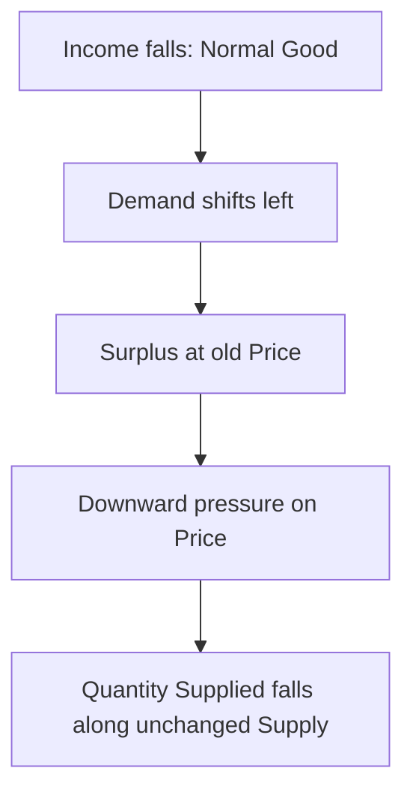

# IC103 L01 + S01 — Deep Notes

Для быстрого повторения: [[IC103 L01 + S01 — Quick Review]].

> [!warning] Source boundaries — 18 October 2026
> Папка `sources/` пуста. Lecture 1 PDF, transcript, Tutorial 1 questions, solutions и optional Labubu PPTX сейчас недоступны. Поэтому это готовые учебные заметки по доступной теме, **не подтверждённый полный конспект Lecture 1**.
> Основа: ранее сохранённые `Obsidian Notes/Quick Review.md` и `Obsidian Notes/Deep Notes.md` (вторичный источник); доступный фрагмент диалога «Изучение Economics лекции» (Q6–Q7); уточнения пользователя о более ранних затруднениях. Числа Q6–Q7 сверены с доступным диалогом; Q1–Q5, Q8–Q10 и Labubu перенесены из прежних заметок, оригиналы сейчас не сверены. Алгебра Q8/Q10 проверена по перенесённым формулам. Дополнительные примеры и схемы — учебные пояснения, не изображения Lecturer.
> Прежние заявления «по источнику» и «сверено с Solutions» не считаются новой проверкой. Для полного покрытия Lecture 1 и transcript нужны оригинальные файлы.

## Personal learning record

> [!important] Это карта затруднений, а не отметка «всё усвоено»
> Полноценного Independent Test без подсказок не было. Понимание после объяснения и самостоятельное применение — разные уровни проверки.

| Topic | Что известно | Что повторить |
|---|---|---|
| Opportunity Cost vs Benefit | По твоему описанию диалога: понял после подсказки | Назвать next-best alternative и отделить его от результата выбора |
| Demand vs Quantity Demanded | Было затруднение; самостоятельная повторная проверка не подтверждена | Вся Curve vs точка; Shift vs Movement Along |
| Demand vs Supply shifts, Q2 | По твоему описанию: путал, после объяснения понял | Input Costs → Supply; Income → Demand; объяснить без подсказки |
| Ceteris Paribus | Причинность требует повторения | Указать, что меняется и что удерживается неизменным |
| Surplus, Q6/Q7b(i) | Q6: выбрал C; Q7: верно назвал Surplus и исходные количества | Сам вычислить разницу и дать полный WHY. «Because of government policy» недостаточно |
| Equilibrium, Q7a | Сам назвал £2 и 50; перевод в 50,000 kg разъяснил assistant | Всегда писать единицы и период |
| Minimum Price, Q7b(ii) | Ошибка: ответил, что £2 недоступны; после объяснения повторного ответа нет | £1.50 — нижняя граница; £2 разрешены; nonbinding |
| Tutorial Q8–Q10 | Не закончены в учебном диалоге | Решить самостоятельно; приведённые ниже ответы не подтверждают освоение |
| Optional Labubu | Необязательный, самостоятельный разбор не подтверждён | Сделать после основной части |

## Lecture 1 — требуется исходный файл

Без файла нельзя проверить полный список тем, определения Lecturer, примеры, формулы и графики. В частности, Opportunity Cost включён ниже по твоему запросу и истории ошибок; его наличие и формулировка в Lecture 1 пока не подтверждены.

## Дополнительные объяснения — основа

### Opportunity Cost vs Benefit

Когда время или другие доступные возможности ограничены, выбор одного действия означает отказ от другого.

**Benefit** описывает то, что ты получаешь от выбранного действия. **Opportunity Cost** описывает ценность **next-best alternative forgone** — лучшего доступного варианта, от которого пришлось отказаться.

Представь два взаимоисключающих варианта на ближайший час:

| Вариант | Что он даёт |
|---|---|
| Учиться | Лучше понять материал |
| Работать | Получить £15 |

Если ты выбираешь учиться и работа была лучшей отвергнутой возможностью, Opportunity Cost этого часа — £15. Понимание материала — Benefit от учёбы.

Если ты выбираешь работать, Opportunity Cost — ценность того часа учёбы, от которого пришлось отказаться. Эта ценность не обязана иметь готовую денежную оценку.

> [!danger] Исправление ошибки
> Не отвечай на вопрос об Opportunity Cost описанием того, что даёт выбранный вариант: это Benefit. Спроси: «Какой лучший вариант я теперь не могу выбрать и что он дал бы?»

Не складывай ценность всех отвергнутых возможностей: одновременно использовать их обычно нельзя. И не считай Opportunity Cost всегда равным денежным расходам. При более сложной задаче учитывай условия: возможны и прямые расходы, и упущенные возможности; не считай одну и ту же потерю дважды.

### Demand vs Quantity Demanded

**Demand** — вся зависимость между Price и количеством, которое Buyers готовы и могут купить за определённый период, при прочих равных. На графике это **вся Demand Curve**.

**Quantity Demanded**, $Q_D$, — одно значение при выбранной Price. На графике это **точка на Demand Curve**.

Пример: при £10 готовы купить 20 units, при £8 — 30 units. Если изменилась только собственная текущая Price с £10 на £8, Quantity Demanded выросла с 20 до 30. Demand Curve осталась прежней.

Если товар стал популярнее и при прежних £10 теперь готовы купить 35 units, изменилась Demand: Curve сдвинулась вправо.

**Law of Demand:** при прочих равных, более высокая собственная Price обычно соответствует меньшей Quantity Demanded. Условие **ceteris paribus** означает, что остальные влияющие условия считаются неизменными.

> [!tip] Проверка одной Price
> Мысленно удержи собственную Price на прежнем уровне. Если при ней теперь хотят купить другое количество из-за иного фактора — это Shift. Если изменилась только собственная Price — Movement Along.

### Ceteris Paribus — причинность

Мы меняем один Factor, чтобы проследить его отдельный эффект; остальные Determinants удерживаем неизменными. Это условие модели, а не заявление, что в жизни всё постоянно.

Own Price ↑ → Quantity Demanded ↓ **при неизменных Income, Tastes и других Demand Determinants**. Если одновременно вырос Income, одних наблюдений Price и Quantity недостаточно, чтобы выделить эффект Own Price.

Для Normal Good: Income ↓ → Demand shifts left → при прежней Price появляется Surplus → Price ↓ → Quantity Supplied ↓ вдоль прежней Supply Curve. Последнее звено не означает Shift of Supply: Input Costs и Technology не менялись.



### Supply vs Quantity Supplied

**Supply** — вся зависимость между Price и количеством, которое Sellers готовы и могут предложить за определённый период. **Quantity Supplied**, $Q_S$, — конкретное количество при конкретной Price.

При прочих равных, собственная Price ↑ обычно вызывает Quantity Supplied ↑ вдоль Supply Curve. Если Input Costs ↑, при той же Price производить становится менее привлекательно: Supply Curve сдвигается влево.

**Labour Input Costs** и **Electricity Costs** относятся к условиям производства. **Consumers’ Income** относится к возможностям Buyers. Поэтому они непосредственно действуют на разные Curves.

### Demand Determinants

| Factor | Как рассуждать |
|---|---|
| Income | Для Normal Good: Income ↑ → Demand ↑. Для Inferior Good: Income ↑ → Demand ↓ |
| Tastes | Товар стал привлекательнее → Demand ↑ |
| Number of Buyers | При прочих равных больше Buyers → Market Demand ↑ |
| Expectations | Ожидаемая будущая Price ↑ может увеличить Demand сегодня |
| Price of Substitute | Альтернатива подорожала → Demand рассматриваемого товара ↑ |
| Price of Complement | Связанный в использовании товар подорожал → Demand рассматриваемого товара ↓ |

**Substitutes** можно использовать вместо друг друга: например, два сопоставимых напитка. **Complements** используют вместе: например, conventional cars и petrol в модели Tutorial.

Всегда называй рассматриваемый Market. Price of Cars — собственная Price в Market for Cars, но Price of Related Good в Market for Petrol. Одно событие может означать Movement Along в первом Market и Shift во втором.

Для Inferior Good слово «inferior» описывает связь с Income, а не обязательно плохое качество. Если тип товара не дан, нельзя автоматически назначать направление Shift после изменения Income.

### Supply Determinants

Input Costs ↑ → Supply ↓. Улучшение Technology при прочих равных → Supply ↑. Другие возможные факторы: Number of Sellers, Taxes/Subsidies для производства, Expectations Sellers и природные условия для соответствующих товаров. Этот расширенный перечень — дополнительное объяснение, а не проверенный список Lecture 1.

### Твоя ошибка — Demand не сдвигает Supply автоматически

Твоя версия: «Income ↓ → Demand ↓ → Supply Curve идёт влево».

Для Normal Good правильная цепочка при неизменных условиях производства:

1. Income ↓ → Demand Curve → left.
2. При прежней Price появляется Surplus.
3. Price испытывает давление вниз.
4. При более низкой Price Sellers выбирают меньшую Quantity Supplied **на прежней Supply Curve**.
5. Новый Equilibrium имеет меньшие Price и Quantity.

Снижение фактически продаваемого количества само по себе не доказывает Shift of Supply.

## Дополнительные объяснения — как читать графики

### Оси и Equilibrium

На стандартном графике вертикальная ось — Price, горизонтальная — Quantity за заданный период. Demand Curve идёт вниз вправо; Supply Curve идёт вверх вправо. Их пересечение $E$ задаёт $P^*$ и $Q^*$.

Чтобы прочитать координаты $E$, проведи от него горизонтальную линию к оси Price и вертикальную — к оси Quantity. Условие:

$$Q_D(P^*)=Q_S(P^*)=Q^*.$$

Не сравнивай высоты точек при разных Price, чтобы доказать Shift. Сравнивай количества на старой и новой Curve **при одной Price**.

### Как нарисовать Shift

1. Подпиши оси $P$ и $Q$, исходные $D_0$ и $S_0$.
2. Отметь пересечение $E_0$, значения $P_0$ и $Q_0$.
3. Назови событие и его прямой Determinant.
4. Нарисуй только обоснованный Shift: например, $D_1$ правее $D_0$.
5. Найди пересечение новой Curve с неизменной второй Curve: $E_1$.
6. Сравни $P_1$ с $P_0$ и $Q_1$ с $Q_0$.

Например, Demand → right при неизменной восходящей Supply: новое пересечение выше и правее, поэтому $P^*↑$, $Q^*↑$. Supply → left при неизменной нисходящей Demand: новое пересечение выше и левее, поэтому $P^*↑$, $Q^*↓$.

Если обе Curves сдвигаются, направление одной координаты может зависеть от размеров Shifts. Например, Demand → right и Supply → left дают Price ↑, но изменение Quantity без дополнительных данных неизвестно.

### Surplus и Shortage на графике

Проведи горизонтальную линию на рассматриваемой Price. Пересечение с Demand даёт $Q_D$, с Supply — $Q_S$. Горизонтальный промежуток между ними показывает разницу количеств, а не разницу Price.

$$\text{Surplus}=Q_S-Q_D\quad\text{если }Q_S>Q_D.$$

$$\text{Shortage}=Q_D-Q_S\quad\text{если }Q_D>Q_S.$$

При $P>P^*$ возникает Surplus и давление на Price вниз. При $P<P^*$ — Shortage и давление вверх. Это описание стандартной модели с возможностью изменения Price, а не обещание мгновенного изменения в каждом реальном Market.

### Формулы и ограничения

Если:

$$Q_D=a-bP,\qquad Q_S=c+dP,\qquad b,d>0,$$

то:

$$a-bP=c+dP\Rightarrow P^*=\frac{a-c}{b+d}.$$

После этого найди $Q^*$ через обе формулы. Если получаются отрицательные Price или Quantity, проверь условия и область применимости модели. Не используй формулы механически вне допустимых значений.

## Встроенные графики

Схемы ниже — моноширинные графики прямо в Markdown: работают без плагинов и внешних файлов. Они качественные, не в масштабе; точные числа Q7 даны в таблице. `P` = Price, `Q` = Quantity, `D` = Demand, `S` = Supply, `E` = Equilibrium.

### Demand, Supply и Equilibrium

```text
Price (P)
  ^  D           S
  |   \         /
  |    \       /
  |     \     /
  |      \   /
  |       \ /
P*|........E
  |       /|\
  |      / | \
  +--------|------------> Quantity (Q)
           Q*
```

E обозначает единственное пересечение D и S; направляющие дают $P^*$ и $Q^*$. Схема условная: положение букв не является числовой координатой.

### Demand shifts right — Supply unchanged

```text
P
^  D0      D1
|   \       \
P0---A-------B-----  same Price
|     \       \
+-----|-------|----> Q
      Q0      Q1
         --->
```

При той же Price: $Q_1>Q_0$. При неизменной восходящей Supply новое E выше и правее: $P^*↑$, $Q^*↑$. При Demand shifts left всё наоборот.

### Supply shifts left — Demand unchanged

```text
P
^     S1      S0
|      /       /
P0----A-------B-----  same Price
|    /       /
+----|-------|------> Q
     Q1      Q0
        <---
```

При той же Price: $Q_1<Q_0$. При неизменной Demand новое E выше и левее: $P^*↑$, $Q^*↓$. При Supply shifts right: $P^*↓$, $Q^*↑$.

### Surplus / binding Minimum Price

```text
Price (P)
  ^   D                 S
  |    \               /
3 |-----A=============B----- Minimum Price = 3
  |      \           /
  |       \         /
  |        \       /
  |         \     /
  |          \   /
2 |...........E........... P* = 2
  |          /|\
  +-----|-----|-------|---> Quantity
        QD    Q*      QS
        <--- Surplus --->
```

Q7: при £3, $Q_D=40$, $Q_S=62$ (000 kg/week); Surplus $=22,000$ kg/week. Price испытывает давление вниз, но binding Minimum Price запрещает снижение к £2. Само ограничение не сдвигает Curves. График качественный, расстояния не в масштабе.

### Shortage / nonbinding Minimum Price

```text
Price (P)
  ^   D             S
  |    \           /
  |     \         /
  |      \       /
  |       \     /
  |        \   /
2 |.........E............. P* = 2: allowed
  |        / \
1.5|------A===B------------ Minimum Price = 1.50
  |      /     \
  +------|--|--|----------> Quantity
         QS Q* QD
         Shortage at 1.50
```

Q7: при самой Price £1.50, $Q_S=45$, $Q_D=55$ (000 kg/week), Shortage $=10,000$ kg/week. Но Minimum Price не заставляет торговать по £1.50: рост до £2 разрешён. Окончательный E остаётся £2 и 50,000 kg/week, без Shortage. Если $P_{min}=P^*$, исходный E также разрешён: положительного Surplus в этой модели нет.

## Tutorial 1 — решения

Ниже краткие разборы Q1–Q10 по вторичным заметкам. Буквы ответов и точные формулировки требуют сверки с оригиналом. Наличие готового решения не означает, что ты решил задачу самостоятельно.

### Question 1 — Demand Determinants

**По вторичным заметкам.** Что НЕ является Demand Determinant?

A. Prices of Related Goods. B. Income. C. Tastes. D. Prices of Inputs used to make the good.

**Ответ: D.** Input Prices непосредственно влияют на Supply. Остальные варианты могут менять Demand.

**Дополнительное объяснение.** Слово NOT меняет цель вопроса: ищи фактор со стороны производства. Изменение Input Prices впоследствии может изменить Equilibrium Price и Quantity Demanded, но это не делает его прямым Demand Determinant.

### Question 2 — Supply Curve → left

**По вторичным заметкам.** Варианты: A — Labour Input Costs ↑; B — Production Techniques улучшились; C — Production Costs ↓; D — Consumers’ Income ↓.

**Ответ: A.** Labour Input Costs ↑ → Production Costs ↑ → при прежней Price Sellers готовы предложить меньше → Supply → left.

B и C дают Supply → right в модели задания. D относится к Demand; направление зависит от типа товара.

> [!danger] Персональное исправление
> Ты выбрал D, связав уменьшение Demand со Shift of Supply. Сначала определи прямой Determinant. Здесь требуется изменение условий производства, поэтому A.

### Question 3 — Price выше Equilibrium Price

**По вторичным заметкам.** Ответ **C**: Sellers хотят предложить больше, чем Buyers хотят купить.

При более высокой Price Quantity Supplied больше, Quantity Demanded меньше. Значит, $Q_S>Q_D$: Surplus. Curves не обязаны сдвигаться.

Числовой пример исходной диаграммы здесь не воспроизводится: оригинал недоступен.

### Question 4 — Shortage

**По вторичным заметкам.** Ответ **B**: возникает upward pressure on Price.

$Q_D>Q_S$: желающих купить при данной Price больше, чем предложено. В стандартной модели Price растёт; Quantity Demanded уменьшается, Quantity Supplied увеличивается вдоль существующих Curves, пока разница не исчезнет.

**Дополнительное объяснение.** Не пиши «Price обязательно немедленно вырастет»: ограничения или задержки могут препятствовать изменению. Вопрос проверяет направление давления.

### Question 5 — Expectations

**По вторичным заметкам.** Buyers ожидают будущую Price ↑. Ответ **D**: Demand сегодня ↑.

Текущая Price не изменилась. Изменились Expectations, поэтому речь о Shift of Demand, а не о Movement Along. Условие говорит о Buyers, поэтому ответы про Supply из него не следуют.

**Дополнительное объяснение.** Механизм особенно понятен для покупок, которые можно перенести на сегодня. Это модель ответа Tutorial, а не универсальное утверждение обо всех товарах.

### Question 6 — beanie hats

**По вторичным заметкам.** Daily Schedule:

| Price | Quantity Demanded | Quantity Supplied |
|---|---:|---:|
| £10 | 10 | 100 |
| £8 | 20 | 80 |
| £6 | 30 | 60 |
| £4 | 40 | 40 |

При £8:

$$Q_S-Q_D=80-20=60\text{ hats/day}.$$

**Ответ: C — Surplus 60 hats; Price имеет тенденцию падать.** Из таблицы также видно: Equilibrium — £4 и 40 hats/day.

**Дополнительное объяснение.** 80 — сколько готовы предложить, а не гарантированно проданное количество. При £8 Buyers готовы купить только 20. Разницу 60 нельзя назвать Shortage, поскольку больше именно $Q_S$.

### Question 7 — tomatoes и Minimum Price

**По вторичным заметкам.** Weekly Schedule; Quantity указана в **000 kg**:

| Price per kg | Quantity Demanded, 000 kg | Quantity Supplied, 000 kg |
|---|---:|---:|
| £4.00 | 30 | 80 |
| £3.50 | 35 | 68 |
| £3.00 | 40 | 62 |
| £2.50 | 45 | 55 |
| £2.00 | 50 | 50 |
| £1.50 | 55 | 45 |
| £1.00 | 60 | 38 |

**a. Equilibrium:** £2/kg и **50,000 kg/week**, поскольку $Q_D=Q_S=50$ тысяч kg.

**b(i). Minimum Price £3/kg:**

$$Q_S-Q_D=(62-40)\times1000=22,000\text{ kg/week}.$$

Возникает Surplus. Price не разрешено упасть до £2, поэтому через обычное снижение Price он не исчезает.

**b(ii). Minimum Price £1.50/kg:** при самой Price £1.50:

$$Q_D-Q_S=(55-45)\times1000=10,000\text{ kg/week}.$$

Вторичные заметки передают вывод Solutions: Price может подняться, чтобы восстановить Equilibrium.

> [!important] Дополнительное уточнение — non-binding Price Floor
> Minimum Price £1.50 запрещает только более низкие Price. Он разрешает £2. Поэтому окончательный Equilibrium остаётся £2/kg и 50,000 kg/week. Устойчивого Shortage от такого Price Floor нет. Shortage 10,000 kg относится к ситуации, **если Price в данный момент равна £1.50**.

**Как нарисовать:** $D$ вниз вправо, $S$ вверх вправо; пересечение на £2 и 50 тысячах kg. Горизонталь £3 проходит выше пересечения: $Q_D=40$, $Q_S=62$. Горизонталь £1.50 проходит ниже, но не запрещает Price подняться к пересечению.

**Дополнительное объяснение.** Minimum Price = Price Floor; выше $P^*$ он binding. Maximum Price = Price Ceiling; это верхняя граница и другой механизм. При £3 без дополнительной информации нельзя утверждать, что все 62,000 kg будут куплены: в простой модели без Government Purchases Buyers хотят купить 40,000 kg.

### Question 8 — computers

> [!todo] Не завершено пользователем
> Ниже готовый разбор для проверки после самостоятельной попытки.


**По вторичным заметкам:**

$$Q_D=100-6P,\qquad Q_S=28+3P.$$

При Equilibrium:

$$100-6P=28+3P,$$
$$100-28=3P+6P,$$
$$72=9P\Rightarrow P^*=8.$$

Подстановка:

$$Q_D=100-6(8)=52,$$
$$Q_S=28+3(8)=52.$$

**Ответ на вопрос о Quantity: 52 computers.** Из приведённых формул получается Price £8.

**Дополнительное объяснение графика.** Для вертикальной оси Price можно переписать:

$$P=\frac{100-Q}{6}\quad(D),\qquad P=\frac{Q-28}{3}\quad(S).$$

Отметь $E$ с горизонтальной координатой 52 и вертикальной 8. Отрицательные Price при продолжении прямых — математическое продолжение, а не необходимая часть рассматриваемого Market.

### Question 9 — petrol

> [!todo] Не завершено пользователем
> Направления ниже — ориентир для самопроверки.


**По вторичным заметкам.** Рассматривается именно Market for Petrol.

| Событие | Прямой эффект | При неизменной второй Curve |
|---|---|---|
| a. Price of Cars ↑ | Petrol Demand → left, поскольку Complements | $P^*↓$, $Q^*↓$ |
| b. Car-owning Population ↑ | Petrol Demand → right | $P^*↑$, $Q^*↑$ |
| c. Transport Cost of Shipping Oil ↑ | Petrol Supply → left | $P^*↑$, $Q^*↓$ |
| d. Environmental Concerns ↑ | Petrol Demand → left | $P^*↓$, $Q^*↓$ |
| e. Taxes on Electric Cars отменены | По модели задания petrol Demand → left | $P^*↓$, $Q^*↓$ |

**a.** Более высокая Price of Cars уменьшает Quantity Demanded for Cars вдоль их Demand Curve. По пересказу Solutions во вторичных заметках меньше использования conventional cars уменьшает Demand for Petrol.

**c.** Shipping Costs — часть Production/Supply Costs. Это не прямой Shift of Petrol Demand. Buyers покупают меньше из-за более высокой новой Price: Movement Along the Demand Curve.

**e.** Во вторичных заметках указано предположение Solutions: что electric cars становятся дешевле относительно conventional cars и их использование уменьшает потребность в petrol.

**Дополнительное объяснение.** В a и e изменения использования машин могут занимать время. Направления описывают механизм учебной модели при прочих равных, а не скорость эффекта или точный прогноз реального Market.

### Question 10 — software programme

> [!todo] Не завершено пользователем
> Самостоятельное применение формул ещё не проверено.


**По вторичным заметкам:**

$$Q_D=348-4P+0.15Y,$$
$$Q_S=600+100P,$$

где $P$ — Price, $Y$ — Income.

#### a. При P = £12 и Y = £10,000

$$Q_D=348-4(12)+0.15(10,000)=348-48+1500=1800.$$

$$Q_S=600+100(12)=1800.$$

**Да, Market находится в Equilibrium:** $Q_D=Q_S=1800$ units.

#### b. Income вырос на 5%

$$Y_1=10,000(1.05)=10,500.$$

На этом шаге сохраняем прежнюю Price £12:

$$Q_D=348-48+0.15(10,500)=1875,$$
$$Q_S=600+100(12)=1800.$$

$$\text{Shortage}=1875-1800=75\text{ units}.$$

**Ответ: Shortage 75 units при £12.** Изменился Demand Determinant — Income. Supply Curve не сдвигалась.

#### c. Новый Equilibrium Price

Используем новый Income и неизвестную Price:

$$348-4P+0.15(10,500)=600+100P,$$
$$1923-4P=600+100P,$$
$$1323=104P,$$
$$P^*=\frac{1323}{104}\approx£12.72.$$

Получено из формул, перенесённых из вторичных заметок.

**Дополнительная проверка Quantity:**

$$Q^*=600+100\left(\frac{1323}{104}\right)\approx1872.12.$$

Через Demand:

$$1923-4\left(\frac{1323}{104}\right)\approx1872.12.$$

В линейной модели дробная Quantity допустима как расчётное значение. Не округляй Price до £12.72 перед точной проверкой: иначе $Q_D=1872.12$, а $Q_S=1872$ из-за промежуточного округления.

**Как нарисовать:** первоначальная $D_0: Q=1848-4P$; новая $D_1: Q=1923-4P$. При каждой Price Quantity Demanded выросла на 75 units: $D_1$ правее $D_0$. Supply прежняя. $E_0=(1800,12)$; $E_1\approx(1872.12,12.72)$. При росте Price происходит Movement Along новой Demand Curve и прежней Supply Curve.

> [!tip] Три разных состояния
> До изменения Income: Equilibrium 1800. После изменения Income при прежней Price: Shortage 75. После изменения Price: новый Equilibrium около 1872.12. Не смешивай эти состояния в одном ответе.

## Optional Labubu case

### Пересказ Optional Question Solution по вторичным заметкам — оригинал не сверён

**Вопрос:** как Demand и Supply объясняют, почему некоторые Labubu продаются дороже Retail Price?

- Slide 1: постановка вопроса.
- Slide 2: blind boxes скрывают конкретную версию; Collectors интересуются редкими версиями, Social Media и Fandom привлекают внимание.
- Slide 3: Tastes, Collector Culture, Social Media и привлекательность blind boxes усиливают Demand; Demand Curve → right.
- Slide 4: Limited Production, редкость отдельных версий и Restocking Delays ограничивают доступность; Supply не всегда быстро реагирует на рост Demand.
- Slide 5: при Retail Price $Q_D>Q_S$ возможны Shortage и Sold-outs.
- Slide 6: Resale Market позволяет Price приблизиться к Market-clearing Level; Strong Demand и ограниченная Supply помогают объяснить более высокие Resale Prices.

### Дополнительное объяснение — график

Нарисуй $D$ и $S$, их пересечение $E$. Под ним проведи горизонталь Retail Price $P_r$. На этой горизонтали $Q_S$ находится левее $Q_D$; расстояние $Q_D-Q_S$ — Shortage при Retail Price.

Для роста популярности добавь $D_1$ правее $D_0$. При неизменной восходящей Supply новый Equilibrium Price выше. Если в короткий период количество почти фиксировано, можно **как отдельное упрощение** нарисовать почти вертикальную Supply Curve: рост Demand сильнее отражается в Price, чем в Quantity.

Это две связанные иллюстрации; ограниченная Supply сама по себе не доказывает новый Shift влево. Для Shift нужно изменение условий относительно исходного состояния.

### Дополнительное объяснение — аккуратные границы модели

Retail Market и Resale Market могут иметь разных Sellers, доступные количества и правила. Random blind box и уже известная редкая версия не обязательно один и тот же товар. Поэтому схема объясняет механизм качественно, но не позволяет вычислить Resale Price без данных.

Retail Price производителя — не обязательно Government Price Ceiling. И ожидание роста Resale Prices не гарантирует прибыль. В исходных слайдах нет численных данных для расчёта $P^*$ или проверки текущих цен.

**Готовый краткий ответ:** Social Media и Collector Preferences увеличивают Demand for Labubu. Supply может быть ограничена Limited Production и Restocking Delays. Если при Retail Price Quantity Demanded превышает Quantity Supplied, возникает Shortage. В Resale Market Buyers конкурируют за доступные экземпляры, поэтому Price может быть выше Retail Price.

## Active Recall

Закрой ответы. Сначала назови понятие, затем объясни цепочку и при необходимости нарисуй график.

### Вопросы

1. Ты выбрал учёбу вместо лучшей альтернативы — работы за £15. Что здесь Benefit и Opportunity Cost?
2. Почему нельзя сложить ценность всех отвергнутых вариантов?
3. Чем Demand отличается от Quantity Demanded на графике?
4. Собственная текущая Price выросла. Нужно ли рисовать новую Demand Curve?
5. Input Costs выросли. Что происходит при прежней Price?
6. Income уменьшился. Какой информации не хватает, чтобы определить направление Demand Shift?
7. Для Normal Good Demand упала. Почему Quantity Supplied может уменьшиться без Shift of Supply?
8. В какой стороне от $P^*$ находится Price при Surplus в стандартной модели?
9. При $Q_D=55$, $Q_S=45$ тысяч kg чему равен Shortage в kg?
10. Чем Minimum Price £1.50 отличается от фиксированной Price £1.50 в Question 7?
11. Реши $100-6P=28+3P$ и проверь обе Quantity.
12. В Question 10 почему Income ↑ на 5% не означает Quantity Demanded ↑ на 5%?
13. Почему Shortage 75 не является новым Equilibrium Quantity?
14. Shipping Costs ↑ в Market for Petrol: покажи Shift и Movement Along отдельно.
15. Почему Sold-outs у Labubu не доказывают Shift of Supply влево?

> [!check]- Ответы 1–5
> 1. Benefit — результат учёбы; Opportunity Cost — £15, если работа действительно лучшая отвергнутая возможность. 2. Отвергнутые варианты обычно взаимоисключающие; берётся next-best alternative. 3. Вся Curve vs точка при конкретной Price. 4. Нет: Movement Along при прочих равных. 5. При прежней Price Quantity Supplied меньше, Supply → left.

> [!check]- Ответы 6–10
> 6. Нужно знать, Normal Good это или Inferior Good. 7. Demand → left снижает Equilibrium Price; по прежней Supply Curve Quantity Supplied уменьшается. 8. Выше $P^*$. 9. $(55-45)\times1000=10,000$ kg. 10. Minimum Price допускает £2; фиксированная £1.50 не позволяет обычный рост до £2.

> [!check]- Ответы 11–15
> 11. $P=8$, обе Quantity равны 52. 12. $\Delta Q_D=0.15\Delta Y=75$ при прежней Price; это около 4.17% от 1800, а не 5%. 13. Это разница $Q_D-Q_S$ при £12, а новый Equilibrium требует их равенства. 14. Supply → left; новая Price выше, Quantity Demanded ниже вдоль неизменной Demand Curve. 15. Shortage возможен из-за Demand ↑ при неизменной ограниченной Supply.

## Как повторять

Сначала пройди [[IC103 L01 + S01 — Quick Review]], затем реши Questions 7, 8 и 10 без подсказок. После каждой ошибки назови её тип: перепутал Benefit с Opportunity Cost; перепутал Shift с Movement Along; выбрал не тот Determinant; потерял единицы; смешал прежнюю Price с новым Equilibrium. Вернись только к соответствующему разделу и повтори объяснение своими словами.
