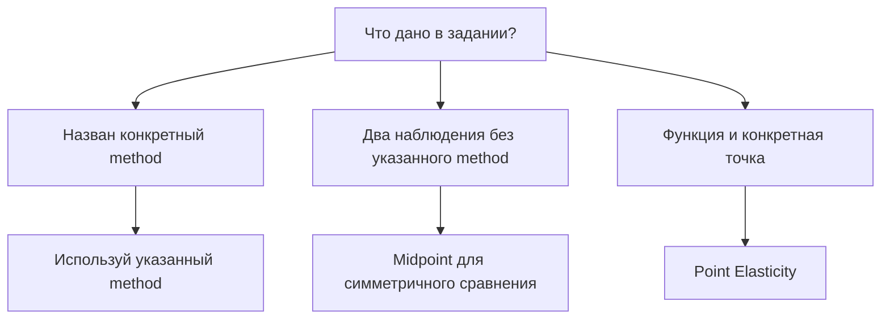

# IC103 L02 — Quick Review

**Повторение за 10–15 минут.** Термины — English, смысл — простыми словами. Разбор и примеры: [[IC103 L02 — Deep Notes]]. Сохрани оба `.md` в одном Obsidian Vault: ссылки между ними будут работать без дополнительных файлов.

> [!abstract] Две идеи всей лекции
> **Elasticity:** насколько сильно меняется quantity при изменении price или income?
> **Consumer Choice:** какой набор товаров человек выберет при своих preferences, income и prices?

## 1. Сначала определи причину изменения

| Measure | Формула | Что изменилось? |
|---|---|---|
| Price Elasticity of Demand — PED | $\%\Delta Q_D/\%\Delta P$ | Собственная price |
| Income Elasticity of Demand — YED | $\%\Delta Q_D/\%\Delta I$ | Income, здесь обозначен $I$ |
| Cross-Price Elasticity of Demand — XED | $\%\Delta Q_A/\%\Delta P_B$ | Price другого товара |
| Price Elasticity of Supply — PES | $\%\Delta Q_S/\%\Delta P$ | Price; реагируют producers |

Elasticity — **коэффициент без единиц**, а не количество товаров и не сумма денег. PED обычно отрицателен; для elastic/inelastic сравнивай с 1 его **absolute value**.

| Absolute PED | Название | Смысл |
|---:|---|---|
| $0$ | Perfectly Inelastic | Quantity не меняется; вертикальная demand curve |
| $0<\lvert PED\rvert<1$ | Inelastic | Quantity реагирует слабее price в процентах |
| $1$ | Unit Elastic | Одинаковая сила процентной реакции |
| $>1$ | Elastic | Quantity реагирует сильнее price в процентах |
| $\infty$ | Perfectly Elastic | Горизонтальная demand curve; чуть выше данной price спрос исчезает |

> [!warning] Ловушка из занятий
> **Unit Elastic не означает «никакой реакции».** Нулевая реакция — PED = 0. При $PED=-1$ рост price на 1% связан примерно с падением quantity на 1% около данной точки.

Close substitutes и возможность отложить покупку обычно делают demand более elastic. Necessities часто более inelastic. Больше времени на перестройку production обычно повышает PES.

## 2. Percentage, Midpoint или Point?

**Percentage Method:** изменения относительно начальных значений.

$$
PED_{\%}=\frac{(Q_2-Q_1)/Q_1}{(P_2-P_1)/P_1}
$$

**Midpoint Method / Arc Elasticity:** изменения относительно средних значений.

$$
PED_{mid}=\frac{(Q_2-Q_1)/[(Q_1+Q_2)/2]}{(P_2-P_1)/[(P_1+P_2)/2]}
$$

Для YED замени $P$ на income $I$; для PES используй $Q_S$.

> [!tip] Зачем Midpoint?
> Оба метода сравнивают **те же два наблюдения**. Percentage спрашивает «на сколько относительно начала?». Midpoint убирает зависимость результата от направления сравнения: A → B и B → A дают один коэффициент. Он не находит новую quantity и не объясняет причину изменения.

Не смешивай Percentage в числителе и Midpoint в знаменателе. Если считаешь долями, например $0.02/0.05$, множители $100\%$ сокращаются.

## 3. Elastic Demand и Total Expenditure

$$TE=TR=P\times Q$$

Это одни деньги с двух сторон: **Total Expenditure** покупателей = **Total Revenue** продавцов в простой модели. TR не равен profit.

| Demand | Price ↑ | Price ↓ |
|---|---|---|
| Elastic | TE / TR ↓ | TE / TR ↑ |
| Inelastic | TE / TR ↑ | TE / TR ↓ |
| Unit Elastic | Без изменения* | Без изменения* |

**Elastic:** price и TR идут в разные стороны. **Inelastic:** в одну сторону.

> [!warning] Твоя основная ловушка
> «Price упала, значит revenue упала» — недостаточно. Quantity тоже меняется. В уже обсуждавшемся примере price ↓20%, quantity ↑5%:
> $TR_2/TR_1=0.80\times1.05=0.84$ → TR ↓16%. Продали больше, но этого недостаточно, чтобы покрыть скидку.

*Таблица точна для Midpoint Elasticity между двумя точками; для Point Elasticity — локальное правило. Для конечных изменений по Percentage Method проверяй непосредственно $P_1Q_1$ и $P_2Q_2$. Одинаковые обычные проценты роста и падения не всегда взаимно компенсируются.*

## 4. YED и Expenditure Proxy

| YED | Тип | Income ↑ при прежних prices |
|---:|---|---|
| $<0$ | Inferior Good | Quantity ↓ |
| $0<YED<1$ | Normal Good, Necessity | Quantity ↑ слабее income |
| $=1$ | Unit Income Elastic | Quantity ↑ пропорционально income |
| $>1$ | Normal Good, Luxury | Quantity ↑ сильнее income |

**Сначала знак, потом величина.** Положительный YED означает Normal Good, даже если YED намного больше 1. Inferior не означает «плохого качества».

> [!important] «Как считать YED, если нет Qd?»
> В таблице Tutorial 2 даны **expenditure**, а не physical quantity. Solutions разрешают использовать их как proxy для demand, предполагая, что prices существенно не изменились.
> При постоянной price $E=PQ$ → $\%\Delta E=\%\Delta Q$. Если prices менялись, нужна quantity $Q=E/P$; один рост expenditure ещё не доказывает рост quantity.

YED = 0.39 читается: income ↑1% → quantity примерно ↑0.39% при прочих равных. Это **income inelastic**, а о PED из этого ничего не следует. Подробный разбор уже начатых расчётов: [[IC103 L02 — Deep Notes#5. YED и Expenditure Proxy]].

XED: **Substitutes → positive**, **Complements → negative**. В числителе quantity A, в знаменателе price B. PES обычно positive; $PES<1$ — слабая, но возможная реакция supply.

## 5. Point Elasticity

$$PED_{point}=\frac{dQ}{dP}\frac{P}{Q}$$

- $dQ/dP$ — на сколько **единиц** меняется quantity при очень маленьком изменении price около точки.
- $P/Q$ — превращает реакцию в единицах в относительную реакцию.
- На графике с price по вертикали slope = $dP/dQ$, поэтому $PED=(1/\text{slope})\times P/Q$.

> [!warning] Почему на straight-line Demand Curve elasticity меняется?
> Не из-за изменения derivative: на прямой она постоянна. Меняется **$P/Q$**. Вверху прямой demand обычно elastic, в середине unit elastic, внизу inelastic.

## 6. Utility → Consumer Surplus → Choice

| Term | Смысл |
|---|---|
| Total Utility — TU | Вся satisfaction от потребления |
| Marginal Utility — MU | Дополнительная satisfaction от ещё одной единицы |
| Diminishing Marginal Utility | Каждая следующая единица обычно даёт меньше дополнительной satisfaction |
| Willingness to Pay — WTP | Максимальная сумма, которую готов заплатить |
| Consumer Surplus — CS | WTP минус фактические расходы |

Если MU выражена в деньгах: $MCS=MU-P$. В one-good model покупка следующей единицы выгодна при $MU>P$; interior optimum — $MU=P$. Это **не** означает нулевой Total Consumer Surplus: предыдущие единицы могли дать положительный surplus.

Для нескольких goods, в стандартном interior optimum:

$$\frac{MU_X}{P_X}=\frac{MU_Y}{P_Y}$$

Это **Equi-Marginal Principle**: одинаковая дополнительная utility от последнего £1 по каждому товару.

## 7. Indifference Curve и Budget Line

**Indifference Curve:** разные bundles с одинаковой utility. Обычно downward sloping и convex; более высокая curve лучше, curves не пересекаются.

**MRS:** сколько Y готов отдать ради дополнительной единицы X при той же utility. Здесь MRS — положительная величина; slope Indifference Curve = $-MRS$.

Пусть X — горизонтальная ось, Y — вертикальная, $I$ — income:

$$P_XQ_X+P_YQ_Y=I$$
$$Q_Y=\frac{I}{P_Y}-\frac{P_X}{P_Y}Q_X$$

| Что меняется? | X-intercept | Y-intercept | Budget Line |
|---|---|---|---|
| Income ↑, prices прежние | ↑ | ↑ | Parallel shift outward |
| $P_X$ ↓, $I,P_Y$ прежние | ↑ | Прежний | Rotation outward, более пологая |
| $P_X$ ↑, $I,P_Y$ прежние | ↓ | Прежний | Rotation inward, более крутая |

> [!tip] Как не путать Rotation и Shift
> Спроси: «Если весь income потратить на Y, сколько Y можно купить?» Если менялась только price X, ответ прежний. Значит, Y-intercept остаётся на месте и Budget Line поворачивается вокруг него.

**Optimal Consumer Choice:** самый высокий достижимый Indifference Curve. В гладком interior optimum — tangency, $MRS=P_X/P_Y$. Только пересечения линий недостаточно.

## 8. Income–Consumption Curve и Price–Consumption Curve

| Curve | Что меняем? | Что держим постоянным? | Какие точки соединяем? |
|---|---|---|---|
| Income–Consumption Curve — ICC | Income | Prices, preferences | Optimal bundles $(Q_X,Q_Y)$ |
| Price–Consumption Curve — PCC | Price одного good | Income, другая price, preferences | Optimal bundles $(Q_X,Q_Y)$ |
| Demand Curve | Собственную price | Income, другие demand determinants | Pairs $(Q_X,P_X)$ |

**PCC не является Demand Curve.** Из каждого optimal bundle возьми quantity X и соответствующую price X. Перенеси эти пары на график, где по вертикали price, по горизонтали quantity → получишь Demand Curve.

## 9. Substitution Effect и Income Effect

**Substitution Effect:** изменились relative prices. **Income Effect:** изменилось real purchasing power; nominal income может остаться прежним.

| Изменение | Тип X | Substitution Effect на X | Income Effect на X | Total Effect на X |
|---|---|---|---|---|
| $P_X$ ↑ | Normal | ↓ | ↓ | ↓ |
| $P_X$ ↑ | Inferior | ↓ | ↑ | Зависит от силы effects; в слайдах ↓ |
| $P_X$ ↓ | Normal | ↑ | ↑ | ↑ |
| $P_X$ ↓ | Inferior | ↑ | ↓ | Зависит от силы effects; обычно ↑ |

> [!warning] Две ошибки, которые нужно убрать
> Budget Line показывает **что доступно**, а не какой good normal или inferior. Тип good определяется изменением выбранной quantity при изменении income и прежних prices.
> Для Inferior Good Income Effect противодействует Substitution Effect. Он не обязательно его перевешивает.

## 10. Проверка без подсказок

Закрой заметку и объясни своими словами:

- [ ] Почему $\lvert PED\rvert=1$ не означает отсутствие реакции?
- [ ] Почему при Elastic Demand снижение price может повысить TE?
- [ ] Зачем Midpoint использует средние **и income, и quantity/expenditure**?
- [ ] При каком условии expenditure заменяет quantity в YED?
- [ ] Что меняется в Point Elasticity вдоль straight-line Demand Curve?
- [ ] Какая точка Budget Line остаётся неподвижной при снижении $P_X$?
- [ ] Чем отличаются оси PCC и Demand Curve?
- [ ] Почему при $P_X$ ↑ Income Effect для Inferior Good направлен к увеличению X?

Разбор трудных мест: [[IC103 L02 — Deep Notes#11. Мои слабые места и как их проверять]].

> [!info] Основа заметки и Tutorial
> Lecture 2 slides, PDF pp. 4–66; transcript; Tutorial 2 и пояснение к expenditure proxy в Tutorial 2 Solutions, PDF p. 4; Tutorial 3 — для выбора тем повторения. Персональные акценты основаны на доступных сообщениях пользователя в чате IC103. Здесь нет ключей к неразобранным Tutorial 2/3: theory и отдельные учебные примеры не заменяют самостоятельное решение.
